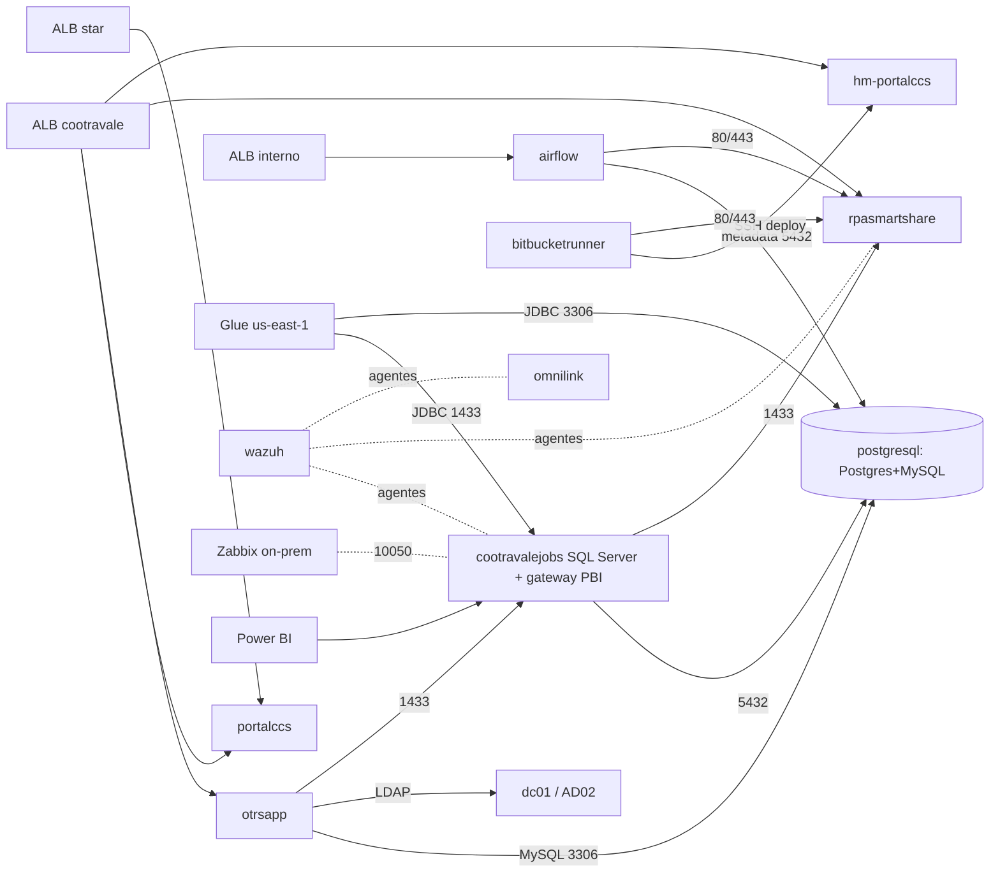

# AWS - Dependências entre servidores

Quem usa quem, deduzido de security groups, DNS, ALB, conexões Glue e README dos projetos. Hub: [[Hub - AWS Computação]] · [[AWS - Mapa]]

## Pontos únicos de falha
- [[EC2 - srv-prod-postgresql]]: Airflow prod + OTRS.
- [[EC2 - srv-prod-dc01]]: único AD ativo ([[EC2 - Srv_AD02]] parado).
- [[EC2 - srv-prod-portalccs]]: ~9 aplicativos públicos em 1 instância.
- [[EC2 - srv-prod-cootravalejobs]]: SQL Server + gateway Power BI + jobs.

## Saturação
- [[EC2 - srv-prod-rpasmartshare]] CPU 76% média; [[EC2 - srv-prod-postgresql]] 47%.
