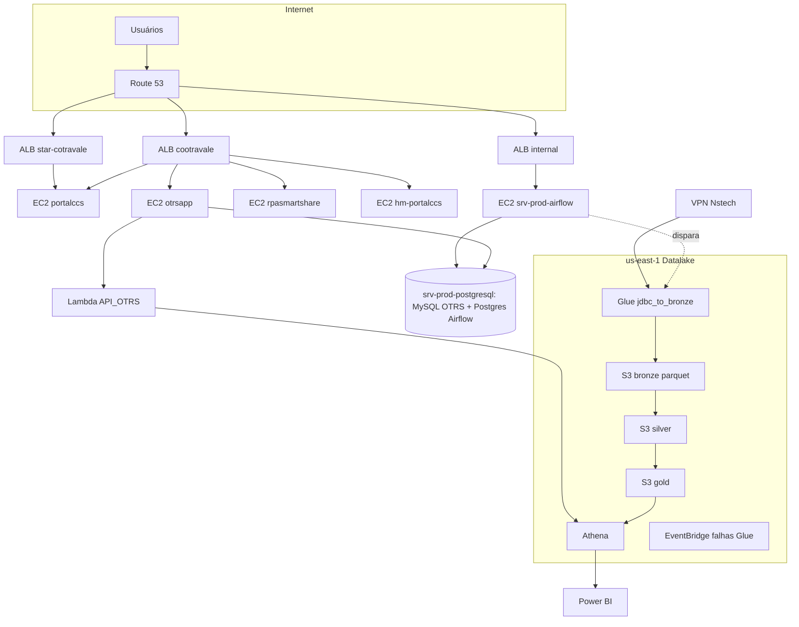

# AWS - Mapa

Hub: [[Hub - AWS]]

## Navegação
- Dependências: [[AWS - Dependências entre servidores]]
- Dependências: [[AWS - Dependências entre servidores]]
- Computação: [[AWS - EC2 (índice)]] · [[AWS - Lambdas (índice)]]
- Dados (parquet): [[S3 - Datalake]] · [[AWS - Glue Jobs]] · [[AWS - Glue Crawlers e Conexões]] · [[AWS - Athena]] · [[AWS - S3 (índice)]]
- Rede: [[AWS - Rede]] · [[ALB - cootravale]] · [[ALB - star-cotravale]] · [[ALB - cootravale-internal]]
- Operação: [[AWS - Monitoramento]] · [[AWS - IAM]] · [[AWS - Tags]] · [[AWS - Achados]]
- Projetos mapeados: [[datalake-glue]] · [[airflow-prod-dags]] · [[API_Lambda]] · [[otrs]] · [[Portal]] · [[IaC]] · [[dw_aso]] · [[Apolo11]]
- Fora da AWS: [[Hub - AWS Hosts e Sites]] (on-premises, Locaweb, fontes Nstech, referências sem instância) · VPCs: [[VPC - cootravale-01]] · [[VPC - cootravale-02]] · [[VPC - cootravale-prod-us-east]]
