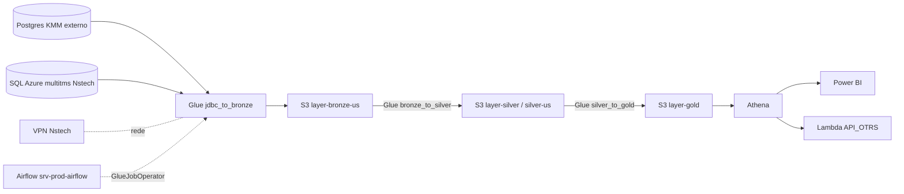

# S3 - Datalake

Mapa do datalake Medallion em Parquet: bucket → database Glue → Athena.

Hub: [[Hub - AWS]] · [[datalake-glue]] · [[AWS - Athena]] · [[AWS - Glue Jobs]] · [[AWS - Lambdas (índice)]] (legado + API_OTRS)

> As Lambdas de ingestão (`prd_ingestion_*`) estão inativas desde 2025; a ingestão atual é o job Glue `jdbc_to_bronze` disparado pelo Airflow.

## Camadas
- [[S3 - cootravale-layer-bronze]] — Bronze (sa-east-1, original).
- [[S3 - cootravale-layer-bronze-us]] — Bronze us-east-1 (prd_bronze/hml_bronze).
- [[S3 - cootravale-layer-silver]] — Silver (silver_kmn, silver_multi, silver_tms).
- [[S3 - cootravale-layer-silver-us]] — Silver us-east-1 (prd_silver/hml_silver).
- [[S3 - cootravale-layer-gold]] — Gold (gold, prd_gold, hml_gold, 3_gold).
- [[S3 - cootravale-infrabi-consumer]] — Consumer da stack infrabi (agings, faturamento, kmm...).
- [[S3 - cootravale-infrabi-staging]] — Staging infrabi (taxa).
- [[S3 - cootravale-infrabi-landing]] — Landing infrabi.
- [[S3 - cootravale-lakekmm]] — Carga KMM (hml_bronze).
- [[S3 - cootravale-lakemultitms]] — Carga multi TMS.
- [[S3 - cootravale-datalake-portal]] — Dados do portal cooperado (parquet).
- [[S3 - cootravale-athena-us]] — Tabelas core_gold/mart_gold.
- [[S3 - cootravale-glue]] — Scripts e temp dos Glue jobs.

## Databases Glue
| Database | Região | Camada | Tabelas | Formatos |
|---|---|---|---|---|
| [[GlueDB - hml_bronze (us-east-1)]] | us-east-1 | bronze | 820 | parquet:816, view:3, LazySimpleSerDe:1 |
| [[GlueDB - prd_bronze (us-east-1)]] | us-east-1 | bronze | 223 | parquet:223 |
| [[GlueDB - 3_gold (us-east-1)]] | us-east-1 | gold | 5 | parquet:5 |
| [[GlueDB - core_gold (us-east-1)]] | us-east-1 | gold | 30 | parquet:30 |
| [[GlueDB - gold (us-east-1)]] | us-east-1 | gold | 11 | parquet:11 |
| [[GlueDB - gold_tms (sa-east-1)]] | sa-east-1 | gold | 1 | view:1 |
| [[GlueDB - hml_gold (us-east-1)]] | us-east-1 | gold | 98 | parquet:75, view:23 |
| [[GlueDB - mart_gold (us-east-1)]] | us-east-1 | gold | 1 | parquet:1 |
| [[GlueDB - prd_gold (us-east-1)]] | us-east-1 | gold | 60 | parquet:32, view:26, LazySimpleSerDe:2 |
| [[GlueDB - agings (sa-east-1)]] | sa-east-1 | outros | 18 | parquet:10, view:8 |
| [[GlueDB - cootravale (sa-east-1)]] | sa-east-1 | outros | 9 | parquet:7, view:2 |
| [[GlueDB - default (us-east-1)]] | us-east-1 | outros | 2 | view:2 |
| [[GlueDB - faturamento (sa-east-1)]] | sa-east-1 | outros | 23 | parquet:12, view:11 |
| [[GlueDB - kmm (sa-east-1)]] | sa-east-1 | outros | 1 | parquet:1 |
| [[GlueDB - multi (sa-east-1)]] | sa-east-1 | outros | 6 | parquet:5, view:1 |
| [[GlueDB - portal_cooperado (sa-east-1)]] | sa-east-1 | outros | 14 | parquet:14 |
| [[GlueDB - sagemaker_sample_db (us-east-1)]] | us-east-1 | outros | 1 | csv:1 |
| [[GlueDB - saldo_realizado (sa-east-1)]] | sa-east-1 | outros | 1 | parquet:1 |
| [[GlueDB - source_kmm (us-east-1)]] | us-east-1 | outros | 1640 | postgresql:1640 |
| [[GlueDB - source_multi_tms (us-east-1)]] | us-east-1 | outros | 4131 | sqlserver:4131 |
| [[GlueDB - taxa (sa-east-1)]] | sa-east-1 | outros | 6 | parquet:4, view:2 |
| [[GlueDB - validation_db (us-east-1)]] | us-east-1 | outros | 5 | parquet:5 |
| [[GlueDB - hml_silver (us-east-1)]] | us-east-1 | silver | 15 | parquet:15 |
| [[GlueDB - prd_silver (us-east-1)]] | us-east-1 | silver | 18 | parquet:18 |
| [[GlueDB - silver_kmn (us-east-1)]] | us-east-1 | silver | 98 | parquet:98 |
| [[GlueDB - silver_multi (us-east-1)]] | us-east-1 | silver | 111 | parquet:111 |
| [[GlueDB - silver_tms (sa-east-1)]] | sa-east-1 | silver | 7 | parquet:7 |
