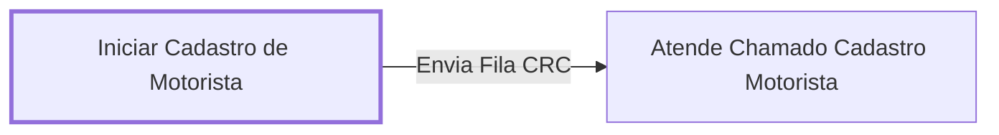

# Processo - Cadastro de Motorista

**Cadastro de Motorista** — estado **Inactive** · criado 2022-07-27 15:30:11 · alterado 2022-10-10 13:51:32

Hub: [[Hub - OTRS Processos]] · [[Hub - OTRS]] · [[otrs]]

Início: **Iniciar Cadastro de Motorista** → diálogo [[Dialog - Formulario de Cadastro de Motorista]]

## Fluxo

## Atividades e diálogos
- **Atende Chamado Cadastro Motorista**: —
- **Iniciar Cadastro de Motorista** (início): [[Dialog - Formulario de Cadastro de Motorista]]

## Transições
- **Envia Fila CRC**: Iniciar Cadastro de Motorista → Atende Chamado Cadastro Motorista
  - Condição: (and: [[DF - CTeReembolsoCircuitos]] Regexp `.`)
  - Ação *Envia Fila>>CRC1* — TicketQueueSet: Fila [[Fila - CRC]]

## ACLs que se aplicam (diretas ou por diálogo)
- nenhuma

> Fonte: snapshot do repo (espelho da prod); fila/serviço aparecem como nomes nas ações.
