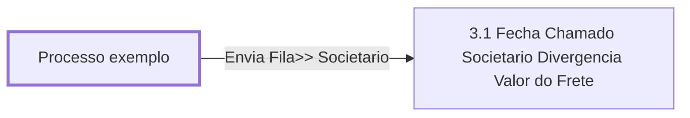

# Processo - Chamado Anulação - Inativo

**Chamado Anulação - Inativo** — estado **Inactive** · criado 2020-11-23 14:32:00 · alterado 2022-01-12 10:42:05

Hub: [[Hub - OTRS Processos]] · [[Hub - OTRS]] · [[otrs]]

Início: **Processo exemplo** → diálogo [[Dialog - Formulário Anulação]]

## Fluxo

## Atividades e diálogos
- **3.1 Fecha Chamado Societario Divergencia Valor do Frete**: [[Dialog - Formulário Anulação]]
- **Processo exemplo** (início): [[Dialog - Formulário Anulação]]

## Transições
- **Envia Fila>> Societario**: Processo exemplo → 3.1 Fecha Chamado Societario Divergencia Valor do Frete
  - Condição: (and: [[DF - CteClienteTipoNestle]] String `NAONESTLE`; [[DF - CteDB]] Regexp `.`; [[DF - CtePlaca]] Regexp `.`)
  - Ação *Atribuir>>Tabela: Anulação* — DynamicFieldSet: <OTRS_TICKET_DynamicField_TabelaAnulacao>=`testado`

## ACLs que se aplicam (diretas ou por diálogo)
- nenhuma

> Fonte: snapshot do repo (espelho da prod); fila/serviço aparecem como nomes nas ações.
