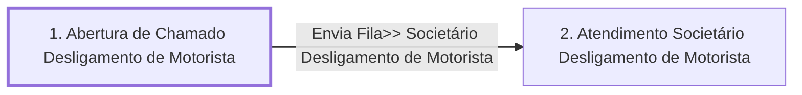

# Processo - Chamado Desligamento de Motorista

**Chamado Desligamento de Motorista** — estado **Active** · criado 2021-10-25 11:08:51 · alterado 2026-07-29 17:39:10

Hub: [[Hub - OTRS Processos]] · [[Hub - OTRS]] · [[otrs]]

Início: **1. Abertura de Chamado Desligamento de Motorista** → diálogo [[Dialog - Formulário Desligamento de Motorista]]

## Fluxo

## Atividades e diálogos
- **1. Abertura de Chamado Desligamento de Motorista** (início): [[Dialog - Formulário Desligamento de Motorista]]
- **2. Atendimento Societário Desligamento de Motorista**: —

## Transições
- **Envia Fila>> Societário Desligamento de Motorista**: 1. Abertura de Chamado Desligamento de Motorista → 2. Atendimento Societário Desligamento de Motorista
  - Condição: (and: [[DF - MotoristaNome]] Regexp `.`)
  - Ação *Envia Fila>> Societário Desligamento de Motorista* — TicketQueueSet: Fila [[Fila - CRC]]
  - Ação *Atribuir>>Titulo Processo: Desligamento de Motorista* — TicketTitleSet: Title=`Processo: Chamado Desligamento de Motorista : <OTRS_TICKET_DynamicField_MotoristaNomeDB>`
  - Ação *Atribuir>>Serviço Processo: Desligamento de Motorista* — TicketServiceSet: Serviço [[Servico - Processo- Chamado Desligamento de Motorista]]
  - Ação *Atribuir>>SLA Processo: Chamado Desligamento de Motorista* — TicketSLASet: SLA [[SLA - SLA Padrão]]

## ACLs que se aplicam (diretas ou por diálogo)
- nenhuma

> Fonte: snapshot do repo (espelho da prod); fila/serviço aparecem como nomes nas ações.
