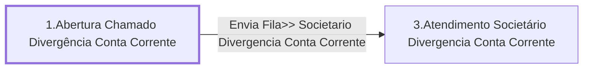

# Processo - Chamado Divergência Conta Corrente

**Chamado Divergência Conta Corrente** — estado **Active** · criado 2021-04-08 09:52:55 · alterado 2021-12-15 13:42:04

Hub: [[Hub - OTRS Processos]] · [[Hub - OTRS]] · [[otrs]]

Início: **1.Abertura Chamado Divergência Conta Corrente** → diálogo [[Dialog - Formulario Divergencia Conta Corrente]]

## Fluxo

## Atividades e diálogos
- **1.Abertura Chamado Divergência Conta Corrente** (início): [[Dialog - Formulario Divergencia Conta Corrente]]
- **3.Atendimento Societário Divergencia Conta Corrente**: [[Dialog - Formulario Divergencia Conta Corrente]]

## Transições
- **Envia Fila>> Societario Divergencia Conta Corrente**: 1.Abertura Chamado Divergência Conta Corrente → 3.Atendimento Societário Divergencia Conta Corrente
  - Condição: (and: `Subject` Regexp `.`)
  - Ação *Atribui>>Titulo Processo Divergencia Conta Corrente* — TicketTitleSet: Title=`Divergência Conta Corrente`

## ACLs que se aplicam (diretas ou por diálogo)
- nenhuma

> Fonte: snapshot do repo (espelho da prod); fila/serviço aparecem como nomes nas ações.
