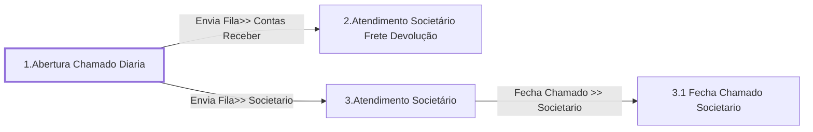

# Processo - Chamado Diária na Devolução

**Chamado Diária na Devolução** — estado **Active** · criado 2023-01-26 15:20:05 · alterado 2026-01-28 11:05:22

Hub: [[Hub - OTRS Processos]] · [[Hub - OTRS]] · [[otrs]]

Início: **1.Abertura Chamado Diaria** → diálogo [[Dialog - Formulário Diária]]

## Fluxo

## Atividades e diálogos
- **1.Abertura Chamado Diaria** (início): [[Dialog - Formulário Diária]]
- **2.Atendimento Societário Frete Devolução**: [[Dialog - Formulário Frete Devolução]] · [[Dialog - Adcionar Valor Previsível da Estadia]]
- **3.1 Fecha Chamado Societario**: [[Dialog - Formulário Diária de Devolução]]
- **3.Atendimento Societário**: [[Dialog - Formulário Diária de Devolução]] · [[Dialog - Controle Atendimento Processo (aadcb8)]]

## Transições
- **Fecha Chamado >> Societario**: 3.Atendimento Societário → 3.1 Fecha Chamado Societario
  - Condição: (and: [[DF - CteControleAtividades]] String `Finalizar Atendimento Societario`; [[DF - CteDB]] Regexp `.`; [[DF - CtePlaca]] Regexp `.`)
  - Ação *Muda Estado Chamado >> Fechado* — TicketStateSet: StateID=`2`
- **Envia Fila>> Societario**: 1.Abertura Chamado Diaria → 3.Atendimento Societário
  - Condição: (and: [[DF - CteClienteTipoNestle]] String `NAONESTLE`; [[DF - CteDB]] Regexp `.`; [[DF - CtePlaca]] Regexp `.`)
  - Ação *Envia Fila>> Societario* — TicketQueueSet: Fila [[Fila - CRC]]
  - Ação *Atribui>>Serviço Processo: Chamado Diária na Devolução* — TicketServiceSet: Serviço [[Servico - Processo- Chamado Diária na Devolução]]
  - Ação *Atribui>>Titulo Processo* — TicketTitleSet: Title=`Placa: <OTRS_TICKET_DynamicField_CtePlaca> | CT-e :<OTRS_TICKET_DynamicField_CteNumero> | Cliente : <OTRS_TICKET_DynamicField_CteNomePagador>`
- **Envia Fila>> Contas Receber**: 1.Abertura Chamado Diaria → 2.Atendimento Societário Frete Devolução
  - Condição: (and: [[DF - CteClienteTipoNestle]] String `NESTLE`; [[DF - CteDB]] Regexp `.`; [[DF - CtePlaca]] Regexp `.`)
  - Ação *Envia Fila>> Contas Receber* — TicketQueueSet: Fila [[Fila - Contas a Receber]]
  - Ação *Atribui>>Serviço Processo: Chamado Diária na Devolução* — TicketServiceSet: Serviço [[Servico - Processo- Chamado Diária na Devolução]]
  - Ação *Atribui>>Titulo Processo* — TicketTitleSet: Title=`Placa: <OTRS_TICKET_DynamicField_CtePlaca> | CT-e :<OTRS_TICKET_DynamicField_CteNumero> | Cliente : <OTRS_TICKET_DynamicField_CteNomePagador>`

## ACLs que se aplicam (diretas ou por diálogo)
- [[ACL - 1 - Esconde Campos Chamado - Ativo]]
- [[ACL - 1- Esconde Anexo Posicao Rastreador HelpDeskTransportador]]
- [[ACL - 1- Esconde CET BRF HelpDeskTransportador]]
- [[ACL - 1- Esconde Numero Registro BRF HelpDeskTransportador]]
- [[ACL - 1- Esconde Senha Marfrig HelpDeskTransportador]]
- [[ACL - 2 Mostra Diária na Devolução - CTE assinado e Rastreamento]]
- [[ACL - 2- Mostra Anexo Posicao Rastreador Processo - DIÁRIA AO DESCARREGAR]]
- [[ACL - 2- Mostra Campos Chamado]]
- [[ACL - 2- Mostra Numero Registro BRF Processo - DIÁRIA AO DESCARREGAR]]
- [[ACL - 2- Mostra Ocorrencia Todos Processos  NESTLE]]
- [[ACL - 2- Mostra Senha Marfrig Processos - DIÁRIA]]
- [[ACL - 3- Esconde Ocorrencia Todos Processos  Não NESTLE]]

> Fonte: snapshot do repo (espelho da prod); fila/serviço aparecem como nomes nas ações.
