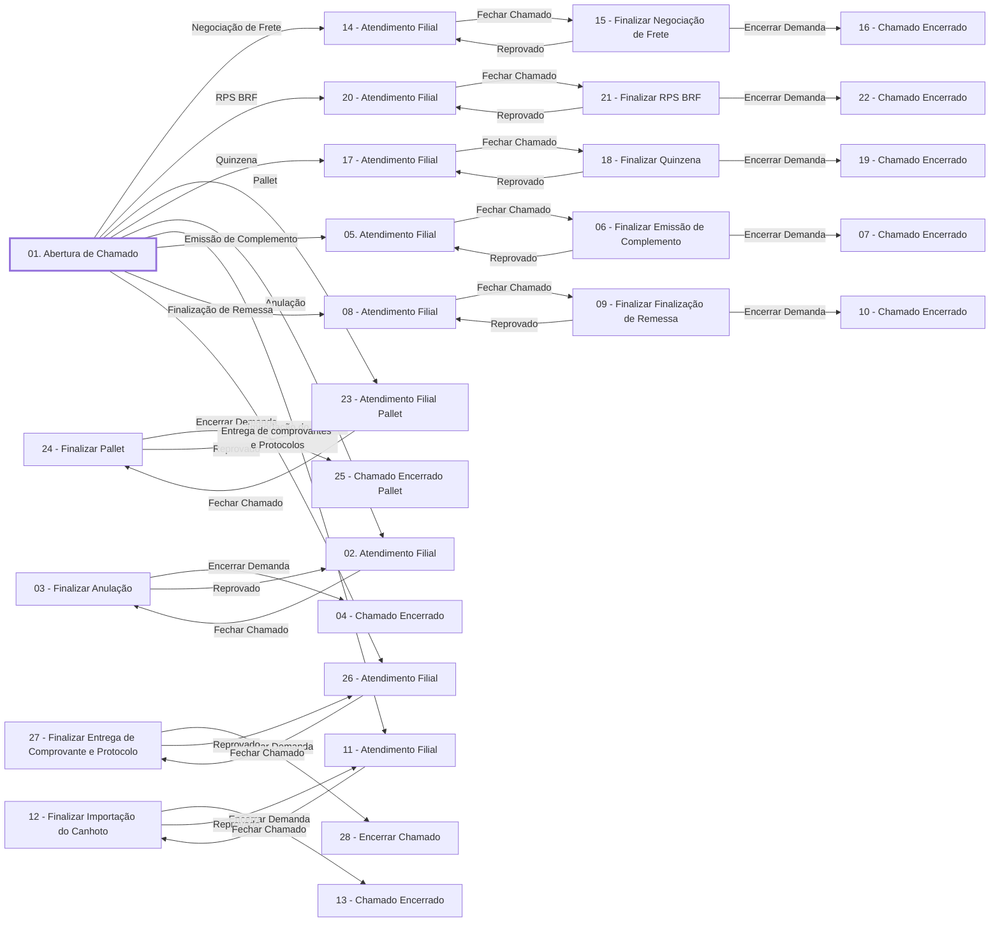

# Processo - Chamado Fila Contas a Receber

**Chamado Fila Contas a Receber** — estado **Inactive** · criado 2021-12-10 10:41:15 · alterado 2023-07-03 09:32:55

Hub: [[Hub - OTRS Processos]] · [[Hub - OTRS]] · [[otrs]]

Início: **01. Abertura de Chamado** → diálogo [[Dialog - Formulário Contas a Receber]]

## Fluxo

## Atividades e diálogos
- **01. Abertura de Chamado** (início): [[Dialog - Formulário Contas a Receber]]
- **02. Atendimento Filial**: [[Dialog - Formulário Resposta Anulação]]
- **03 - Finalizar Anulação**: [[Dialog - Encerrar Demanda]]
- **04 - Chamado Encerrado**: —
- **05. Atendimento Filial**: [[Dialog - Formulário Resposta Emissão Complementar]]
- **06 - Finalizar Emissão de Complemento**: [[Dialog - Encerrar Demanda]]
- **07 - Chamado Encerrado**: —
- **08 - Atendimento Filial**: [[Dialog - Formulário Resposta Finalização de Remessa]]
- **09 - Finalizar Finalização de Remessa**: [[Dialog - Encerrar Demanda]]
- **10 - Chamado Encerrado**: —
- **11 - Atendimento Filial**: [[Dialog - Formulário Resposta Importação do Canhoto]]
- **12 - Finalizar Importação do Canhoto**: [[Dialog - Encerrar Demanda]]
- **13 - Chamado Encerrado**: [[Dialog - Encerrar Demanda]]
- **14 - Atendimento Filial**: [[Dialog - Formulário Resposta Negociação de Frete]]
- **15 - Finalizar Negociação de Frete**: [[Dialog - Encerrar Demanda]]
- **16 - Chamado Encerrado**: —
- **17 - Atendimento Filial**: [[Dialog - Formulário Resposta Quinzena]]
- **18 - Finalizar Quinzena**: [[Dialog - Encerrar Demanda]]
- **19 - Chamado Encerrado**: —
- **20 - Atendimento Filial**: [[Dialog - Formulário Resposta RPS BRF]]
- **21 - Finalizar RPS BRF**: [[Dialog - Encerrar Demanda]]
- **22 - Chamado Encerrado**: —
- **23 - Atendimento Filial Pallet**: [[Dialog - Formulário  Resposta Pallet]]
- **24 - Finalizar Pallet**: [[Dialog - Encerrar Demanda]]
- **25 - Chamado Encerrado Pallet**: —
- **26 - Atendimento Filial**: [[Dialog - Formulário Resposta Entrega de comprovantes e Protocolos]]
- **27 - Finalizar Entrega de Comprovante e Protocolo**: [[Dialog - Encerrar Demanda]]
- **28 - Encerrar Chamado**: —

## Transições
- **Fechar Chamado**: 17 - Atendimento Filial → 18 - Finalizar Quinzena
  - Condição: (or: [[DF - Demanda]] String `Anulação`; [[DF - DemandaRealizada]] String `Sim`) and (or: [[DF - Demanda]] String `Emissão de Complementar`; [[DF - DemandaRealizada]] String `Sim`) and (or: [[DF - Demanda]] String `Finalização de Remessa`; [[DF - DemandaRealizada]] String `Sim`) and (or: [[DF - Demanda]] String `Importação do Canhoto`; [[DF - DemandaRealizada]] String `Sim`) and (or: [[DF - Demanda]] String `Negociação de Frete`; [[DF - DemandaRealizada]] String `Sim`) and (or: [[DF - Demanda]] String `Quinzena`; [[DF - DemandaRealizada]] String `Sim`) and (or: [[DF - Demanda]] String `RPS BRF`; [[DF - DemandaRealizada]] String `Sim`) and (or: [[DF - DemandaRealizada]] String `Sim`; `Dynamicfiled_Demanda` String `Pallet`) and (or: [[DF - DemandaRealizada]] String `Sim`; `Dynamicfiled_Demanda` String `Entrega de Comprovantes e Protocolos`)
  - Ação *Envia Fila CReceber* — TicketQueueSet: Fila [[Fila - Contas a Receber]]
  - Ação *Atribuir Estado Aguardando Aprovação* — TicketStateSet: State=`Aguardando Aprovação`
  - Ação *Atribuir Desbloqueio do Ticket* — TicketLockSet: LockID=`1`
  - Ação *Atribui Responsável Admin* — TicketOwnerSet: OwnerID=`1`
- **Encerrar Demanda**: 24 - Finalizar Pallet → 25 - Chamado Encerrado Pallet
  - Condição: (and: [[DF - EncerrarChamado]] String `Aprovar`; `State` String `Aguardando Aprovação`)
  - Ação *Muda Estado Chamado >> Fechado* — TicketStateSet: StateID=`2`
- **Reprovado**: 24 - Finalizar Pallet → 23 - Atendimento Filial Pallet
  - Condição: (and: [[DF - EncerrarChamado]] String `Reprovar`; `State` String `Aguardando Aprovação`)
  - Ação *Fila Dinamicamente* — TicketQueueSet: Queue=`<OTRS_TICKET_DynamicField_UnidadeNegocio>`
  - Ação *Atribuir Estado Aberto* — TicketStateSet: State=`open`
  - Ação *Atribui Responsável Admin* — TicketOwnerSet: OwnerID=`1`
  - Ação *Atribuir Desbloqueio do Ticket* — TicketLockSet: LockID=`1`
- **Fechar Chamado**: 14 - Atendimento Filial → 15 - Finalizar Negociação de Frete
  - Condição: (or: [[DF - Demanda]] String `Anulação`; [[DF - DemandaRealizada]] String `Sim`) and (or: [[DF - Demanda]] String `Emissão de Complementar`; [[DF - DemandaRealizada]] String `Sim`) and (or: [[DF - Demanda]] String `Finalização de Remessa`; [[DF - DemandaRealizada]] String `Sim`) and (or: [[DF - Demanda]] String `Importação do Canhoto`; [[DF - DemandaRealizada]] String `Sim`) and (or: [[DF - Demanda]] String `Negociação de Frete`; [[DF - DemandaRealizada]] String `Sim`) and (or: [[DF - Demanda]] String `Quinzena`; [[DF - DemandaRealizada]] String `Sim`) and (or: [[DF - Demanda]] String `RPS BRF`; [[DF - DemandaRealizada]] String `Sim`) and (or: [[DF - DemandaRealizada]] String `Sim`; `Dynamicfiled_Demanda` String `Pallet`) and (or: [[DF - DemandaRealizada]] String `Sim`; `Dynamicfiled_Demanda` String `Entrega de Comprovantes e Protocolos`)
  - Ação *Envia Fila CReceber* — TicketQueueSet: Fila [[Fila - Contas a Receber]]
  - Ação *Atribuir Estado Aguardando Aprovação* — TicketStateSet: State=`Aguardando Aprovação`
  - Ação *Atribui Responsável Admin* — TicketOwnerSet: OwnerID=`1`
  - Ação *Atribuir Desbloqueio do Ticket* — TicketLockSet: LockID=`1`
- **Fechar Chamado**: 08 - Atendimento Filial → 09 - Finalizar Finalização de Remessa
  - Condição: (or: [[DF - Demanda]] String `Anulação`; [[DF - DemandaRealizada]] String `Sim`) and (or: [[DF - Demanda]] String `Emissão de Complementar`; [[DF - DemandaRealizada]] String `Sim`) and (or: [[DF - Demanda]] String `Finalização de Remessa`; [[DF - DemandaRealizada]] String `Sim`) and (or: [[DF - Demanda]] String `Importação do Canhoto`; [[DF - DemandaRealizada]] String `Sim`) and (or: [[DF - Demanda]] String `Negociação de Frete`; [[DF - DemandaRealizada]] String `Sim`) and (or: [[DF - Demanda]] String `Quinzena`; [[DF - DemandaRealizada]] String `Sim`) and (or: [[DF - Demanda]] String `RPS BRF`; [[DF - DemandaRealizada]] String `Sim`) and (or: [[DF - DemandaRealizada]] String `Sim`; `Dynamicfiled_Demanda` String `Pallet`) and (or: [[DF - DemandaRealizada]] String `Sim`; `Dynamicfiled_Demanda` String `Entrega de Comprovantes e Protocolos`)
  - Ação *Atribuir Estado Aguardando Aprovação* — TicketStateSet: State=`Aguardando Aprovação`
  - Ação *Envia Fila CReceber* — TicketQueueSet: Fila [[Fila - Contas a Receber]]
  - Ação *Atribui Responsável Admin* — TicketOwnerSet: OwnerID=`1`
  - Ação *Atribuir Desbloqueio do Ticket* — TicketLockSet: LockID=`1`
  - Ação *Título CReceber* — TicketTitleSet: Title=`Demanda: <OTRS_TICKET_DynamicField_Demanda>   <OTRS_TICKET_DynamicField_FilialEmissao> <OTRS_TICKET_DynamicField_CteSerie> <OTRS_TICKET_DynamicField_CteNumero>`
- **Fechar Chamado**: 05. Atendimento Filial → 06 - Finalizar Emissão de Complemento
  - Condição: (or: [[DF - Demanda]] String `Anulação`; [[DF - DemandaRealizada]] String `Sim`) and (or: [[DF - Demanda]] String `Emissão de Complementar`; [[DF - DemandaRealizada]] String `Sim`) and (or: [[DF - Demanda]] String `Finalização de Remessa`; [[DF - DemandaRealizada]] String `Sim`) and (or: [[DF - Demanda]] String `Importação do Canhoto`; [[DF - DemandaRealizada]] String `Sim`) and (or: [[DF - Demanda]] String `Negociação de Frete`; [[DF - DemandaRealizada]] String `Sim`) and (or: [[DF - Demanda]] String `Quinzena`; [[DF - DemandaRealizada]] String `Sim`) and (or: [[DF - Demanda]] String `RPS BRF`; [[DF - DemandaRealizada]] String `Sim`) and (or: [[DF - DemandaRealizada]] String `Sim`; `Dynamicfiled_Demanda` String `Pallet`) and (or: [[DF - DemandaRealizada]] String `Sim`; `Dynamicfiled_Demanda` String `Entrega de Comprovantes e Protocolos`)
  - Ação *Envia Fila CReceber* — TicketQueueSet: Fila [[Fila - Contas a Receber]]
  - Ação *Atribuir Estado Aguardando Aprovação* — TicketStateSet: State=`Aguardando Aprovação`
  - Ação *Atribui Responsável Admin* — TicketOwnerSet: OwnerID=`1`
  - Ação *Atribuir Desbloqueio do Ticket* — TicketLockSet: LockID=`1`
- **Encerrar Demanda**: 03 - Finalizar Anulação → 04 - Chamado Encerrado
  - Condição: (and: [[DF - EncerrarChamado]] String `Aprovar`; `State` String `Aguardando Aprovação`)
  - Ação *Atribuir Estado Chamado Fechado* — TicketStateSet: StateID=`2`
- **Reprovado**: 03 - Finalizar Anulação → 02. Atendimento Filial
  - Condição: (and: [[DF - EncerrarChamado]] String `Reprovar`; `State` String `Aguardando Aprovação`)
  - Ação *Atribuir Fila Filial* — TicketQueueSet: Queue=`<OTRS_TICKET_DynamicField_UnidadeNegocio>`
  - Ação *Atribuir Estado Aberto* — TicketStateSet: State=`open`
  - Ação *Atribui Responsável Admin* — TicketOwnerSet: OwnerID=`1`
  - Ação *Atribuir Desbloqueio do Ticket* — TicketLockSet: LockID=`1`
- **Fechar Chamado**: 02. Atendimento Filial → 03 - Finalizar Anulação
  - Condição: (or: [[DF - Demanda]] String `Anulação`; [[DF - DemandaRealizada]] String `Sim`) and (or: [[DF - Demanda]] String `Emissão de Complementar`; [[DF - DemandaRealizada]] String `Sim`) and (or: [[DF - Demanda]] String `Finalização de Remessa`; [[DF - DemandaRealizada]] String `Sim`) and (or: [[DF - Demanda]] String `Importação do Canhoto`; [[DF - DemandaRealizada]] String `Sim`) and (or: [[DF - Demanda]] String `Negociação de Frete`; [[DF - DemandaRealizada]] String `Sim`) and (or: [[DF - Demanda]] String `Quinzena`; [[DF - DemandaRealizada]] String `Sim`) and (or: [[DF - Demanda]] String `RPS BRF`; [[DF - DemandaRealizada]] String `Sim`) and (or: [[DF - DemandaRealizada]] String `Sim`; `Dynamicfiled_Demanda` String `Pallet`) and (or: [[DF - DemandaRealizada]] String `Sim`; `Dynamicfiled_Demanda` String `Entrega de Comprovantes e Protocolos`)
  - Ação *Envia Fila CReceber* — TicketQueueSet: Fila [[Fila - Contas a Receber]]
  - Ação *Atribuir Estado Aguardando Aprovação* — TicketStateSet: State=`Aguardando Aprovação`
  - Ação *Atribui Responsável Admin* — TicketOwnerSet: OwnerID=`1`
  - Ação *Atribuir Desbloqueio do Ticket* — TicketLockSet: LockID=`1`
  - Ação *Título CReceber* — TicketTitleSet: Title=`Demanda: <OTRS_TICKET_DynamicField_Demanda>   <OTRS_TICKET_DynamicField_FilialEmissao> <OTRS_TICKET_DynamicField_CteSerie> <OTRS_TICKET_DynamicField_CteNumero>`
- **Encerrar Demanda**: 27 - Finalizar Entrega de Comprovante e Protocolo → 28 - Encerrar Chamado
  - Condição: (and: [[DF - EncerrarChamado]] String `Aprovar`; `State` String `Aguardando Aprovação`)
  - Ação *Muda Estado Chamado >> Fechado* — TicketStateSet: StateID=`2`
- **Reprovado**: 27 - Finalizar Entrega de Comprovante e Protocolo → 26 - Atendimento Filial
  - Condição: (and: [[DF - EncerrarChamado]] String `Reprovar`; `State` String `Aguardando Aprovação`)
  - Ação *Fila Dinamicamente* — TicketQueueSet: Queue=`<OTRS_TICKET_DynamicField_UnidadeNegocio>`
  - Ação *Atribuir Estado Aberto* — TicketStateSet: State=`open`
  - Ação *Atribui Responsável Admin* — TicketOwnerSet: OwnerID=`1`
  - Ação *Atribuir Desbloqueio do Ticket* — TicketLockSet: LockID=`1`
- **Fechar Chamado**: 26 - Atendimento Filial → 27 - Finalizar Entrega de Comprovante e Protocolo
  - Condição: (or: [[DF - Demanda]] String `Anulação`; [[DF - DemandaRealizada]] String `Sim`) and (or: [[DF - Demanda]] String `Emissão de Complementar`; [[DF - DemandaRealizada]] String `Sim`) and (or: [[DF - Demanda]] String `Finalização de Remessa`; [[DF - DemandaRealizada]] String `Sim`) and (or: [[DF - Demanda]] String `Importação do Canhoto`; [[DF - DemandaRealizada]] String `Sim`) and (or: [[DF - Demanda]] String `Negociação de Frete`; [[DF - DemandaRealizada]] String `Sim`) and (or: [[DF - Demanda]] String `Quinzena`; [[DF - DemandaRealizada]] String `Sim`) and (or: [[DF - Demanda]] String `RPS BRF`; [[DF - DemandaRealizada]] String `Sim`) and (or: [[DF - DemandaRealizada]] String `Sim`; `Dynamicfiled_Demanda` String `Pallet`) and (or: [[DF - DemandaRealizada]] String `Sim`; `Dynamicfiled_Demanda` String `Entrega de Comprovantes e Protocolos`)
  - Ação *Envia Fila CReceber* — TicketQueueSet: Fila [[Fila - Contas a Receber]]
  - Ação *Atribuir Estado Aguardando Aprovação* — TicketStateSet: State=`Aguardando Aprovação`
  - Ação *Atribui Responsável Admin* — TicketOwnerSet: OwnerID=`1`
  - Ação *Atribuir Desbloqueio do Ticket* — TicketLockSet: LockID=`1`
- **Fechar Chamado**: 20 - Atendimento Filial → 21 - Finalizar RPS BRF
  - Condição: (or: [[DF - Demanda]] String `Anulação`; [[DF - DemandaRealizada]] String `Sim`) and (or: [[DF - Demanda]] String `Emissão de Complementar`; [[DF - DemandaRealizada]] String `Sim`) and (or: [[DF - Demanda]] String `Finalização de Remessa`; [[DF - DemandaRealizada]] String `Sim`) and (or: [[DF - Demanda]] String `Importação do Canhoto`; [[DF - DemandaRealizada]] String `Sim`) and (or: [[DF - Demanda]] String `Negociação de Frete`; [[DF - DemandaRealizada]] String `Sim`) and (or: [[DF - Demanda]] String `Quinzena`; [[DF - DemandaRealizada]] String `Sim`) and (or: [[DF - Demanda]] String `RPS BRF`; [[DF - DemandaRealizada]] String `Sim`) and (or: [[DF - DemandaRealizada]] String `Sim`; `Dynamicfiled_Demanda` String `Pallet`) and (or: [[DF - DemandaRealizada]] String `Sim`; `Dynamicfiled_Demanda` String `Entrega de Comprovantes e Protocolos`)
  - Ação *Envia Fila CReceber* — TicketQueueSet: Fila [[Fila - Contas a Receber]]
  - Ação *Atribuir Estado Aguardando Aprovação* — TicketStateSet: State=`Aguardando Aprovação`
  - Ação *Atribui Responsável Admin* — TicketOwnerSet: OwnerID=`1`
  - Ação *Atribuir Desbloqueio do Ticket* — TicketLockSet: LockID=`1`
- **Encerrar Demanda**: 09 - Finalizar Finalização de Remessa → 10 - Chamado Encerrado
  - Condição: (and: [[DF - EncerrarChamado]] String `Aprovar`; `State` String `Aguardando Aprovação`)
  - Ação *Atribuir Estado Chamado Fechado* — TicketStateSet: StateID=`2`
- **Reprovado**: 09 - Finalizar Finalização de Remessa → 08 - Atendimento Filial
  - Condição: (and: [[DF - EncerrarChamado]] String `Reprovar`; `State` String `Aguardando Aprovação`)
  - Ação *Atribuir Fila Filial* — TicketQueueSet: Queue=`<OTRS_TICKET_DynamicField_UnidadeNegocio>`
  - Ação *Atribuir Estado Aberto* — TicketStateSet: State=`open`
  - Ação *Atribui Responsável Admin* — TicketOwnerSet: OwnerID=`1`
  - Ação *Atribuir Desbloqueio do Ticket* — TicketLockSet: LockID=`1`
  - Ação *Título CReceber* — TicketTitleSet: Title=`Demanda: <OTRS_TICKET_DynamicField_Demanda>   <OTRS_TICKET_DynamicField_FilialEmissao> <OTRS_TICKET_DynamicField_CteSerie> <OTRS_TICKET_DynamicField_CteNumero>`
- **Fechar Chamado**: 23 - Atendimento Filial Pallet → 24 - Finalizar Pallet
  - Condição: (or: [[DF - Demanda]] String `Anulação`; [[DF - DemandaRealizada]] String `Sim`) and (or: [[DF - Demanda]] String `Emissão de Complementar`; [[DF - DemandaRealizada]] String `Sim`) and (or: [[DF - Demanda]] String `Finalização de Remessa`; [[DF - DemandaRealizada]] String `Sim`) and (or: [[DF - Demanda]] String `Importação do Canhoto`; [[DF - DemandaRealizada]] String `Sim`) and (or: [[DF - Demanda]] String `Negociação de Frete`; [[DF - DemandaRealizada]] String `Sim`) and (or: [[DF - Demanda]] String `Quinzena`; [[DF - DemandaRealizada]] String `Sim`) and (or: [[DF - Demanda]] String `RPS BRF`; [[DF - DemandaRealizada]] String `Sim`) and (or: [[DF - DemandaRealizada]] String `Sim`; `Dynamicfiled_Demanda` String `Pallet`) and (or: [[DF - DemandaRealizada]] String `Sim`; `Dynamicfiled_Demanda` String `Entrega de Comprovantes e Protocolos`)
  - Ação *Fila Dinamicamente* — TicketQueueSet: Queue=`<OTRS_TICKET_DynamicField_UnidadeNegocio>`
  - Ação *Atribuir Estado Aguardando Aprovação* — TicketStateSet: State=`Aguardando Aprovação`
  - Ação *Atribui Responsável Admin* — TicketOwnerSet: OwnerID=`1`
  - Ação *Atribuir Desbloqueio do Ticket* — TicketLockSet: LockID=`1`
- **Encerrar Demanda**: 12 - Finalizar Importação do Canhoto → 13 - Chamado Encerrado
  - Condição: (and: [[DF - EncerrarChamado]] String `Aprovar`; `State` String `Aguardando Aprovação`)
  - Ação *Atribuir Estado Chamado Fechado* — TicketStateSet: StateID=`2`
  - Ação *Título CReceber* — TicketTitleSet: Title=`Demanda: <OTRS_TICKET_DynamicField_Demanda>   <OTRS_TICKET_DynamicField_FilialEmissao> <OTRS_TICKET_DynamicField_CteSerie> <OTRS_TICKET_DynamicField_CteNumero>`
- **Reprovado**: 12 - Finalizar Importação do Canhoto → 11 - Atendimento Filial
  - Condição: (and: [[DF - EncerrarChamado]] String `Reprovar`; `State` String `Aguardando Aprovação`)
  - Ação *Atribuir Fila Filial* — TicketQueueSet: Queue=`<OTRS_TICKET_DynamicField_UnidadeNegocio>`
  - Ação *Atribuir Estado Aberto* — TicketStateSet: State=`open`
  - Ação *Atribui Responsável Admin* — TicketOwnerSet: OwnerID=`1`
- **Encerrar Demanda**: 21 - Finalizar RPS BRF → 22 - Chamado Encerrado
  - Condição: (and: [[DF - EncerrarChamado]] String `Aprovar`; `State` String `Aguardando Aprovação`)
  - Ação *Atribuir Estado Chamado Fechado* — TicketStateSet: StateID=`2`
- **Reprovado**: 21 - Finalizar RPS BRF → 20 - Atendimento Filial
  - Condição: (and: [[DF - EncerrarChamado]] String `Reprovar`; `State` String `Aguardando Aprovação`)
  - Ação *Fila Dinamicamente* — TicketQueueSet: Queue=`<OTRS_TICKET_DynamicField_UnidadeNegocio>`
  - Ação *Atribuir Estado Aberto* — TicketStateSet: State=`open`
  - Ação *Atribui Responsável Admin* — TicketOwnerSet: OwnerID=`1`
  - Ação *Atribuir Desbloqueio do Ticket* — TicketLockSet: LockID=`1`
- **Encerrar Demanda**: 06 - Finalizar Emissão de Complemento → 07 - Chamado Encerrado
  - Condição: (and: [[DF - EncerrarChamado]] String `Aprovar`; `State` String `Aguardando Aprovação`)
  - Ação *Atribuir Estado Chamado Fechado* — TicketStateSet: StateID=`2`
- **Reprovado**: 06 - Finalizar Emissão de Complemento → 05. Atendimento Filial
  - Condição: (and: [[DF - EncerrarChamado]] String `Reprovar`; `State` String `Aguardando Aprovação`)
  - Ação *Atribuir Fila Filial* — TicketQueueSet: Queue=`<OTRS_TICKET_DynamicField_UnidadeNegocio>`
  - Ação *Atribuir Estado Aberto* — TicketStateSet: State=`open`
  - Ação *Atribuir Desbloqueio do Ticket* — TicketLockSet: LockID=`1`
  - Ação *Atribui Responsável Admin* — TicketOwnerSet: OwnerID=`1`
- **Encerrar Demanda**: 15 - Finalizar Negociação de Frete → 16 - Chamado Encerrado
  - Condição: (and: [[DF - EncerrarChamado]] String `Aprovar`; `State` String `Aguardando Aprovação`)
  - Ação *Atribuir Estado Chamado Fechado* — TicketStateSet: StateID=`2`
- **Reprovado**: 15 - Finalizar Negociação de Frete → 14 - Atendimento Filial
  - Condição: (and: [[DF - EncerrarChamado]] String `Reprovar`; `State` String `Aguardando Aprovação`)
  - Ação *Fila Dinamicamente* — TicketQueueSet: Queue=`<OTRS_TICKET_DynamicField_UnidadeNegocio>`
  - Ação *Atribuir Estado Aberto* — TicketStateSet: State=`open`
  - Ação *Atribuir Desbloqueio do Ticket* — TicketLockSet: LockID=`1`
  - Ação *Atribui Responsável Admin* — TicketOwnerSet: OwnerID=`1`
  - Ação *Limpa AnexoRetornoCReceber* — DynamicFieldSet: Value=``
- **Fechar Chamado**: 11 - Atendimento Filial → 12 - Finalizar Importação do Canhoto
  - Condição: (or: [[DF - Demanda]] String `Anulação`; [[DF - DemandaRealizada]] String `Sim`) and (or: [[DF - Demanda]] String `Emissão de Complementar`; [[DF - DemandaRealizada]] String `Sim`) and (or: [[DF - Demanda]] String `Finalização de Remessa`; [[DF - DemandaRealizada]] String `Sim`) and (or: [[DF - Demanda]] String `Importação do Canhoto`; [[DF - DemandaRealizada]] String `Sim`) and (or: [[DF - Demanda]] String `Negociação de Frete`; [[DF - DemandaRealizada]] String `Sim`) and (or: [[DF - Demanda]] String `Quinzena`; [[DF - DemandaRealizada]] String `Sim`) and (or: [[DF - Demanda]] String `RPS BRF`; [[DF - DemandaRealizada]] String `Sim`) and (or: [[DF - DemandaRealizada]] String `Sim`; `Dynamicfiled_Demanda` String `Pallet`) and (or: [[DF - DemandaRealizada]] String `Sim`; `Dynamicfiled_Demanda` String `Entrega de Comprovantes e Protocolos`)
  - Ação *Envia Fila CReceber* — TicketQueueSet: Fila [[Fila - Contas a Receber]]
  - Ação *Atribuir Estado Aguardando Aprovação* — TicketStateSet: State=`Aguardando Aprovação`
  - Ação *Atribui Responsável Admin* — TicketOwnerSet: OwnerID=`1`
  - Ação *Atribuir Desbloqueio do Ticket* — TicketLockSet: LockID=`1`
- **Negociação de Frete**: 01. Abertura de Chamado → 14 - Atendimento Filial
  - Condição: (and: [[DF - Demanda]] String `Negociação de Frete`)
  - Ação *Fila Dinamicamente* — TicketQueueSet: Queue=`<OTRS_TICKET_DynamicField_UnidadeNegocio>`
  - Ação *Associar ao Serviço Negociação de Frete* — TicketServiceSet: Serviço [[Servico - Contas a Receber › Negociação de Frete]]
  - Ação *SLA - Chamado Negociação de Frete* — TicketSLASet: SLA [[SLA - SLA - Chamado Negociação de Frete]]
  - Ação *Atribuir Estado Aberto* — TicketStateSet: State=`open`
  - Ação *Título CReceber* — TicketTitleSet: Title=`Demanda: <OTRS_TICKET_DynamicField_Demanda>   <OTRS_TICKET_DynamicField_FilialEmissao> <OTRS_TICKET_DynamicField_CteSerie> <OTRS_TICKET_DynamicField_CteNumero>`
- **RPS BRF**: 01. Abertura de Chamado → 20 - Atendimento Filial
  - Condição: (and: [[DF - Demanda]] String `RPS BRF`)
  - Ação *Fila Dinamicamente* — TicketQueueSet: Queue=`<OTRS_TICKET_DynamicField_UnidadeNegocio>`
  - Ação *SLA - Chamado RPS BRF* — TicketSLASet: SLA [[SLA - RPS BRF]]
  - Ação *Atribuir>>Serviço Processo: Chamado RPS BRF* — TicketServiceSet: Serviço [[Servico - Contas a Receber › RPS BRF]]
  - Ação *Atribuir Estado Aberto* — TicketStateSet: State=`open`
  - Ação *Título CReceber* — TicketTitleSet: Title=`Demanda: <OTRS_TICKET_DynamicField_Demanda>   <OTRS_TICKET_DynamicField_FilialEmissao> <OTRS_TICKET_DynamicField_CteSerie> <OTRS_TICKET_DynamicField_CteNumero>`
- **Pallet**: 01. Abertura de Chamado → 23 - Atendimento Filial Pallet
  - Condição: (and: [[DF - Demanda]] String `Pallet`)
  - Ação *Envia Fila CReceber* — TicketQueueSet: Fila [[Fila - Contas a Receber]]
  - Ação *AtribuirServicoPallet* — TicketServiceSet: Serviço [[Servico - Contas a Receber › Pallet]]
  - Ação *SLA Padrão* — TicketSLASet: SLA [[SLA - SLA Padrão]]
  - Ação *Atribuir Estado Aberto* — TicketStateSet: State=`open`
  - Ação *Título CReceber* — TicketTitleSet: Title=`Demanda: <OTRS_TICKET_DynamicField_Demanda>   <OTRS_TICKET_DynamicField_FilialEmissao> <OTRS_TICKET_DynamicField_CteSerie> <OTRS_TICKET_DynamicField_CteNumero>`
- **Quinzena**: 01. Abertura de Chamado → 17 - Atendimento Filial
  - Condição: (and: [[DF - Demanda]] String `Quinzena`)
  - Ação *Fila Dinamicamente* — TicketQueueSet: Queue=`<OTRS_TICKET_DynamicField_UnidadeNegocio>`
  - Ação *Associar ao Serviço Quinzena* — TicketServiceSet: Serviço [[Servico - Contas a Receber › Quinzenas]]
  - Ação *SLA - Chamado Quinzena* — TicketSLASet: SLA [[SLA - SLA - Chamado Quinzenas]]
  - Ação *Atribuir Estado Aberto* — TicketStateSet: State=`open`
  - Ação *Título CReceber* — TicketTitleSet: Title=`Demanda: <OTRS_TICKET_DynamicField_Demanda>   <OTRS_TICKET_DynamicField_FilialEmissao> <OTRS_TICKET_DynamicField_CteSerie> <OTRS_TICKET_DynamicField_CteNumero>`
- **Anulação**: 01. Abertura de Chamado → 02. Atendimento Filial
  - Condição: (and: [[DF - Demanda]] String `Anulação`)
  - Ação *Fila Dinamicamente* — TicketQueueSet: Queue=`<OTRS_TICKET_DynamicField_UnidadeNegocio>`
  - Ação *Associar ao Serviço Anulação* — TicketServiceSet: Serviço [[Servico - Contas a Receber › Anulação]]
  - Ação *Atribuir SLA ao Chamado* — TicketSLASet: SLA [[SLA - SLA - Chamado Anulação]]
  - Ação *Atribuir Estado Aberto* — TicketStateSet: State=`open`
  - Ação *Título CReceber* — TicketTitleSet: Title=`Demanda: <OTRS_TICKET_DynamicField_Demanda>   <OTRS_TICKET_DynamicField_FilialEmissao> <OTRS_TICKET_DynamicField_CteSerie> <OTRS_TICKET_DynamicField_CteNumero>`
- **Importação do Canhoto**: 01. Abertura de Chamado → 11 - Atendimento Filial
  - Condição: (and: [[DF - Demanda]] String `Importação do Canhoto`)
  - Ação *Fila Dinamicamente* — TicketQueueSet: Queue=`<OTRS_TICKET_DynamicField_UnidadeNegocio>`
  - Ação *Associar ao Serviço Emissão de Canhoto* — TicketServiceSet: Serviço [[Servico - Contas a Receber › Importação do Canhoto]]
  - Ação *SLA - Chamado Importação do Canhoto* — TicketSLASet: SLA [[SLA - SLA - Chamado Importação do Canhoto]]
  - Ação *Atribuir Estado Aberto* — TicketStateSet: State=`open`
  - Ação *Título CReceber* — TicketTitleSet: Title=`Demanda: <OTRS_TICKET_DynamicField_Demanda>   <OTRS_TICKET_DynamicField_FilialEmissao> <OTRS_TICKET_DynamicField_CteSerie> <OTRS_TICKET_DynamicField_CteNumero>`
- **Emissão de Complemento**: 01. Abertura de Chamado → 05. Atendimento Filial
  - Condição: (and: [[DF - Demanda]] String `Emissão de Complemento`)
  - Ação *Fila Dinamicamente* — TicketQueueSet: Queue=`<OTRS_TICKET_DynamicField_UnidadeNegocio>`
  - Ação *Atribuir Estado Aberto* — TicketStateSet: State=`open`
  - Ação *01.1.3 Atribuir>>Serviço Processo: Chamado Emissão de Complementos* — TicketServiceSet: Serviço [[Servico - Contas a Receber › Emissão de Complemento]]
  - Ação *01.1.4 Atribuir>>SLA Processo: Chamado Emissão de Complemento* — TicketSLASet: SLA [[SLA - SLA - Chamado Emissão de Complemento]]
  - Ação *Título CReceber* — TicketTitleSet: Title=`Demanda: <OTRS_TICKET_DynamicField_Demanda>   <OTRS_TICKET_DynamicField_FilialEmissao> <OTRS_TICKET_DynamicField_CteSerie> <OTRS_TICKET_DynamicField_CteNumero>`
- **Finalização de Remessa**: 01. Abertura de Chamado → 08 - Atendimento Filial
  - Condição: (and: [[DF - Demanda]] String `Aprovação de Faturamento`)
  - Ação *Fila Dinamicamente* — TicketQueueSet: Queue=`<OTRS_TICKET_DynamicField_UnidadeNegocio>`
  - Ação *Associar ao Serviço Finalização de Remessa* — TicketServiceSet: Serviço [[Servico - Contas a Receber › Finalização de Remessa]]
  - Ação *SLA - Chamado Finalização de Remessa* — TicketSLASet: SLA [[SLA - SLA - Chamado Finalização Remessa]]
  - Ação *Atribuir Estado Aberto* — TicketStateSet: State=`open`
  - Ação *Título CReceber* — TicketTitleSet: Title=`Demanda: <OTRS_TICKET_DynamicField_Demanda>   <OTRS_TICKET_DynamicField_FilialEmissao> <OTRS_TICKET_DynamicField_CteSerie> <OTRS_TICKET_DynamicField_CteNumero>`
- **Entrega de comprovantes e Protocolos**: 01. Abertura de Chamado → 26 - Atendimento Filial
  - Condição: (and: [[DF - Demanda]] String `Entrega de Comprovantes e Protocolos`)
  - Ação *Fila Dinamicamente* — TicketQueueSet: Queue=`<OTRS_TICKET_DynamicField_UnidadeNegocio>`
  - Ação *Atribui Serviço Entrega de Comprovantes e Protocolos* — TicketServiceSet: Serviço [[Servico - Contas a Receber › Entrega de comprovantes e Protocolos]]
  - Ação *SLA - Chamado Entrega de Comprovantes e Protocolos* — TicketSLASet: SLA [[SLA - SLA - Chamado Entrega de comprovantes e Protocolos]]
  - Ação *Atribuir Estado Aberto* — TicketStateSet: State=`open`
  - Ação *Título CReceber* — TicketTitleSet: Title=`Demanda: <OTRS_TICKET_DynamicField_Demanda>   <OTRS_TICKET_DynamicField_FilialEmissao> <OTRS_TICKET_DynamicField_CteSerie> <OTRS_TICKET_DynamicField_CteNumero>`
- **Encerrar Demanda**: 18 - Finalizar Quinzena → 19 - Chamado Encerrado
  - Condição: (and: [[DF - EncerrarChamado]] String `Aprovar`; `State` String `Aguardando Aprovação`)
  - Ação *Atribuir Estado Chamado Fechado* — TicketStateSet: StateID=`2`
- **Reprovado**: 18 - Finalizar Quinzena → 17 - Atendimento Filial
  - Condição: (and: [[DF - EncerrarChamado]] String `Reprovar`; `State` String `Aguardando Aprovação`)
  - Ação *Fila Dinamicamente* — TicketQueueSet: Queue=`<OTRS_TICKET_DynamicField_UnidadeNegocio>`
  - Ação *Atribuir Estado Aberto* — TicketStateSet: State=`open`
  - Ação *Atribuir Desbloqueio do Ticket* — TicketLockSet: LockID=`1`
  - Ação *Atribui Responsável Admin* — TicketOwnerSet: OwnerID=`1`

## ACLs que se aplicam (diretas ou por diálogo)
- nenhuma

> Fonte: snapshot do repo (espelho da prod); fila/serviço aparecem como nomes nas ações.
