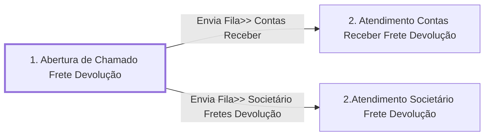

# Processo - Chamado Frete Devolução

**Chamado Frete Devolução** — estado **Active** · criado 2021-07-14 11:08:57 · alterado 2023-07-03 11:20:21

Hub: [[Hub - OTRS Processos]] · [[Hub - OTRS]] · [[otrs]]

Início: **1. Abertura de Chamado Frete Devolução** → diálogo [[Dialog - Formulário Frete Devolução]]

## Fluxo

## Atividades e diálogos
- **1. Abertura de Chamado Frete Devolução** (início): [[Dialog - Formulário Frete Devolução]]
- **2. Atendimento Contas Receber Frete Devolução**: [[Dialog - Formulário Frete Devolução]]
- **2.Atendimento Societário Frete Devolução**: [[Dialog - Formulário Frete Devolução]] · [[Dialog - Adcionar Valor Previsível da Estadia]]

## Transições
- **Envia Fila>> Contas Receber**: 1. Abertura de Chamado Frete Devolução → 2. Atendimento Contas Receber Frete Devolução
  - Condição: (and: [[DF - CteClienteTipoNestle]] String `NESTLE`; [[DF - CteDB]] Regexp `.`; [[DF - CtePlaca]] Regexp `.`)
- **Envia Fila>> Societário Fretes Devolução**: 1. Abertura de Chamado Frete Devolução → 2.Atendimento Societário Frete Devolução
  - Condição: (and: [[DF - CteClienteTipoNestle]] String `CLIENTENAONESTLE`; [[DF - CteDB]] Regexp `.`; [[DF - CtePlaca]] Regexp `.`)
  - Ação *Envia Fila>> Societario Frete Devolucao* — TicketQueueSet: Fila [[Fila - CRC]]
  - Ação *Atribui>>Serviço Processo: Chamado Frete Devolução* — TicketServiceSet: Serviço [[Servico - Processo- Chamado Frete Devolução]]
  - Ação *Atribui>>Titulo Processo Frete Devolução* — TicketTitleSet: Title=`Placa: <OTRS_TICKET_DynamicField_CtePlaca> | CT-e :<OTRS_TICKET_DynamicField_CteNumero> | Cliente : <OTRS_TICKET_DynamicField_CteNomePagador>`

## ACLs que se aplicam (diretas ou por diálogo)
- [[ACL - 1 - Esconde Campos Chamado - Ativo]]
- [[ACL - 2- Mostra Campos Chamado]]

> Fonte: snapshot do repo (espelho da prod); fila/serviço aparecem como nomes nas ações.
