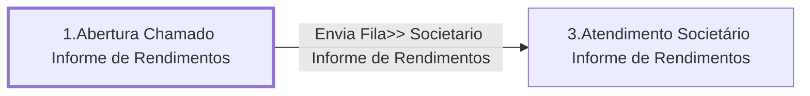

# Processo - Chamado Informe de Rendimentos

**Chamado Informe de Rendimentos** — estado **Active** · criado 2021-04-08 08:32:06 · alterado 2021-12-15 13:45:04

Hub: [[Hub - OTRS Processos]] · [[Hub - OTRS]] · [[otrs]]

Início: **1.Abertura Chamado Informe de Rendimentos** → diálogo [[Dialog - Formulario Informe de Rendimentos (e9074d)]]

## Fluxo

## Atividades e diálogos
- **1.Abertura Chamado Informe de Rendimentos** (início): [[Dialog - Formulario Informe de Rendimentos (e9074d)]]
- **3.Atendimento Societário Informe de Rendimentos**: [[Dialog - Formulario Informe de Rendimentos (e9074d)]]

## Transições
- **Envia Fila>> Societario Informe de Rendimentos**: 1.Abertura Chamado Informe de Rendimentos → 3.Atendimento Societário Informe de Rendimentos
  - Condição: (and: `Subject` Regexp `.`)
  - Ação *Envia Fila>> Societario Informe de Rendimentos* — TicketQueueSet: Fila [[Fila - CRC]]
  - Ação *Atribui>>Titulo Processo Informe de Rendimentos* — TicketTitleSet: Title=`Informe de Rendimentos`
  - Ação *Atribui>>Serviço Processo: Chamado Informe de Rendimentos* — TicketServiceSet: Serviço [[Servico - Processo- Chamado Informe de Rendimentos]]

## ACLs que se aplicam (diretas ou por diálogo)
- nenhuma

> Fonte: snapshot do repo (espelho da prod); fila/serviço aparecem como nomes nas ações.
