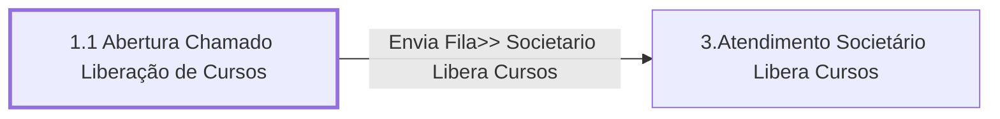

# Processo - Chamado Liberação Treinamento

**Chamado Liberação Treinamento** — estado **Active** · criado 2021-07-01 14:58:50 · alterado 2021-12-15 13:45:11

Hub: [[Hub - OTRS Processos]] · [[Hub - OTRS]] · [[otrs]]

Início: **1.1 Abertura Chamado Liberação de Cursos** → diálogo [[Dialog - 1- Formulário Liberação Cursos]]

## Fluxo

## Atividades e diálogos
- **1.1 Abertura Chamado Liberação de Cursos** (início): [[Dialog - 1- Formulário Liberação Cursos]]
- **3.Atendimento Societário Libera Cursos**: [[Dialog - 1- Formulário Liberação Cursos]]

## Transições
- **Envia Fila>> Societario Libera Cursos**: 1.1 Abertura Chamado Liberação de Cursos → 3.Atendimento Societário Libera Cursos
  - Condição: (and: [[DF - MotoristaNome]] Regexp `.`)
  - Ação *Envia Fila>> Societario Libera Cursos* — TicketQueueSet: Fila [[Fila - CRC]]
  - Ação *Atribui>>Serviço Processo: Chamado Libera Cursos* — TicketServiceSet: Serviço [[Servico - Processo- Chamado Liberação Treinamento]]
  - Ação *Atribui>>Titulo Processo: Chamado Libera Cursos* — TicketTitleSet: Title=`Processo: Chamado Libera Cursos | Motorista: <OTRS_TICKET_DynamicField_MotoristaNome>`

## ACLs que se aplicam (diretas ou por diálogo)
- nenhuma

> Fonte: snapshot do repo (espelho da prod); fila/serviço aparecem como nomes nas ações.
