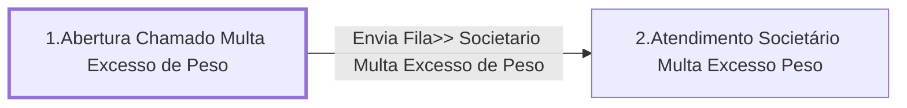

# Processo - Chamado Multa Excesso de Peso

**Chamado Multa Excesso de Peso** — estado **Active** · criado 2022-01-21 10:15:52 · alterado 2022-01-21 15:49:56

Hub: [[Hub - OTRS Processos]] · [[Hub - OTRS]] · [[otrs]]

Início: **1.Abertura Chamado Multa Excesso de Peso** → diálogo [[Dialog - Formulario Multa Excesso de Peso]]

## Fluxo

## Atividades e diálogos
- **1.Abertura Chamado Multa Excesso de Peso** (início): [[Dialog - Formulario Multa Excesso de Peso]]
- **2.Atendimento Societário Multa Excesso Peso**: [[Dialog - Formulario Multa Excesso de Peso]]

## Transições
- **Envia Fila>> Societario Multa Excesso de Peso**: 1.Abertura Chamado Multa Excesso de Peso → 2.Atendimento Societário Multa Excesso Peso
  - Condição: (and: [[DF - CteDB]] Regexp `.`; [[DF - Placa]] Regexp `.`)
  - Ação *Atribui Fila>> Societario Multa Excesso de Peso* — TicketQueueSet: Fila [[Fila - CRC]]
  - Ação *Atribui>>Servico Processo: Chamado Multa Excesso de Peso* — TicketServiceSet: Serviço [[Servico - Processo- Chamado Multa Excesso de Peso]]
  - Ação *Atribui>>Titulo Processo: Chamado Multa Excesso de Peso* — TicketTitleSet: Title=`Placa: <OTRS_TICKET_DynamicField_CtePlaca> | CT-e :<OTRS_TICKET_DynamicField_CteNumero> | Cliente : <OTRS_TICKET_DynamicField_CteNomePagador>`

## ACLs que se aplicam (diretas ou por diálogo)
- nenhuma

> Fonte: snapshot do repo (espelho da prod); fila/serviço aparecem como nomes nas ações.
