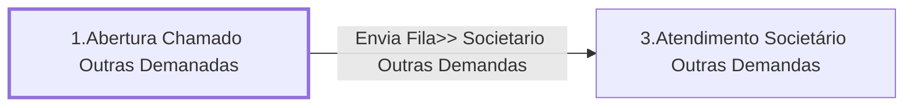

# Processo - Chamado Outras Demandas

**Chamado Outras Demandas** — estado **Active** · criado 2021-04-08 09:22:40 · alterado 2021-12-15 13:45:19

Hub: [[Hub - OTRS Processos]] · [[Hub - OTRS]] · [[otrs]]

Início: **1.Abertura Chamado Outras Demanadas** → diálogo [[Dialog - Formulario Outras Demandas]]

## Fluxo

## Atividades e diálogos
- **1.Abertura Chamado Outras Demanadas** (início): [[Dialog - Formulario Outras Demandas]]
- **3.Atendimento Societário Outras Demandas**: [[Dialog - Formulario Outras Demandas]]

## Transições
- **Envia Fila>> Societario Outras Demandas**: 1.Abertura Chamado Outras Demanadas → 3.Atendimento Societário Outras Demandas
  - Condição: (and: `Subject` Regexp `.`)
  - Ação *Atribui>>Titulo Processo Outras Demandas* — TicketTitleSet: Title=`Processo: Chamado Outras Demandas`

## ACLs que se aplicam (diretas ou por diálogo)
- nenhuma

> Fonte: snapshot do repo (espelho da prod); fila/serviço aparecem como nomes nas ações.
