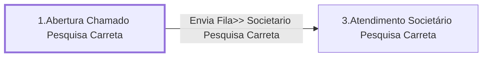

# Processo - Chamado Pesquisa Nova Carreta

**Chamado Pesquisa Nova Carreta** — estado **Active** · criado 2021-04-08 10:37:40 · alterado 2021-12-15 13:45:33

Hub: [[Hub - OTRS Processos]] · [[Hub - OTRS]] · [[otrs]]

Início: **1.Abertura Chamado Pesquisa Carreta** → diálogo [[Dialog - Formulario Pesquisa Carreta]]

## Fluxo

## Atividades e diálogos
- **1.Abertura Chamado Pesquisa Carreta** (início): [[Dialog - Formulario Pesquisa Carreta]]
- **3.Atendimento Societário Pesquisa Carreta**: [[Dialog - Formulario Pesquisa Carreta]]

## Transições
- **Envia Fila>> Societario Pesquisa Carreta**: 1.Abertura Chamado Pesquisa Carreta → 3.Atendimento Societário Pesquisa Carreta
  - Condição: (and: [[DF - PesqCarreta]] Regexp `.`)
  - Ação *Envia Fila>> Societario Pesquisa Carreta* — TicketQueueSet: Fila [[Fila - CRC]]
  - Ação *Atribui>>Titulo Processo Pesquisa Carreta* — TicketTitleSet: Title=`Pesquisa Carreta Placa : <OTRS_TICKET_DynamicField_PesqCarreta> | Placa Cavalo : <OTRS_TICKET_DynamicField_PesqCarretaPlacaCavalo>`

## ACLs que se aplicam (diretas ou por diálogo)
- nenhuma

> Fonte: snapshot do repo (espelho da prod); fila/serviço aparecem como nomes nas ações.
