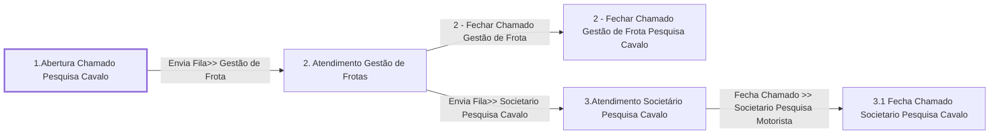

# Processo - Chamado Pesquisa Novo Cavalo (Melhoria - Teste) - Inativo

**Chamado Pesquisa Novo Cavalo (Melhoria - Teste) - Inativo** — estado **Inactive** · criado 2021-11-26 14:00:34 · alterado 2022-01-12 10:41:44

Hub: [[Hub - OTRS Processos]] · [[Hub - OTRS]] · [[otrs]]

Início: **1.Abertura Chamado Pesquisa Cavalo** → diálogo [[Dialog - Formulario Pesquisa Cavalo (f7b22b)]]

## Fluxo

## Atividades e diálogos
- **1.Abertura Chamado Pesquisa Cavalo** (início): [[Dialog - Formulario Pesquisa Cavalo (f7b22b)]]
- **2 - Fechar Chamado Gestão de Frota Pesquisa Cavalo**: —
- **2. Atendimento Gestão de Frotas**: [[Dialog - Formulario Pesquisa Cavalo (f7b22b)]] · [[Dialog - 2 - Formulário Controle Atividade Frota]]
- **3.1 Fecha Chamado Societario Pesquisa Cavalo**: [[Dialog - Formulario Pesquisa Cavalo (f7b22b)]]
- **3.Atendimento Societário Pesquisa Cavalo**: [[Dialog - Formulario Pesquisa Cavalo (f7b22b)]] · [[Dialog - Controle Atendimento Processo (28e1b7)]] · [[Dialog - 2 - Formulário Controle Atividade Frota]]

## Transições
- **Fecha Chamado >> Societario Pesquisa Motorista**: 3.Atendimento Societário Pesquisa Cavalo → 3.1 Fecha Chamado Societario Pesquisa Cavalo
  - Condição: (and: [[DF - CteControleAtividades]] String `Finalizar Atendimento Societario`)
  - Ação *Muda Estado Chamado >> Fechado* — TicketStateSet: StateID=`2`
- **Envia Fila>> Gestão de Frota**: 1.Abertura Chamado Pesquisa Cavalo → 2. Atendimento Gestão de Frotas
  - Condição: (and: [[DF - PesqCavalo]] Regexp `.`)
  - Ação *Atribuir>> Campo Aprovação Gestão de Frota* — DynamicFieldSet: DynamicField_ControleAprovacaoFrota=`Selecione`
  - Ação *Envia Fila>> Gestão de Frota Pesquisa Cavalo* — TicketQueueSet: Fila [[Fila - Gestão de Frota]]
  - Ação *Atribui>>Titulo Processo Pesquisa Cavalo* — TicketTitleSet: Title=`Pesquisa Cavalo : <OTRS_TICKET_DynamicField_PesqCavalo> | Carreta : <OTRS_TICKET_DynamicField_PesqCavaloPlacaCarreta>`
  - Ação *Atribui>>Servico Processo: Chamado Pesquisa Cavalo* — TicketServiceSet: Serviço [[Servico - Processo- Chamado Pesquisa Cavalo]]
- **Envia Fila>> Societario Pesquisa Cavalo**: 2. Atendimento Gestão de Frotas → 3.Atendimento Societário Pesquisa Cavalo
  - Condição: (and: [[DF - ControleAprovacaoFrota]] String `Aprovado`)
  - Ação *Envia Fila>> Societario Pesquisa Cavalo* — TicketQueueSet: Fila [[Fila - CRC]]
- **2 - Fechar Chamado Gestão de Frota**: 2. Atendimento Gestão de Frotas → 2 - Fechar Chamado Gestão de Frota Pesquisa Cavalo
  - Condição: (and: [[DF - ControleAprovacaoFrota]] String `Reprovado`)
  - Ação *Chamado Fechado Gestão de Frota* — TicketStateSet: StateID=`2`

## ACLs que se aplicam (diretas ou por diálogo)
- [[ACL - 7 - Esconde Campo Aprovação Formulário]]

> Fonte: snapshot do repo (espelho da prod); fila/serviço aparecem como nomes nas ações.
