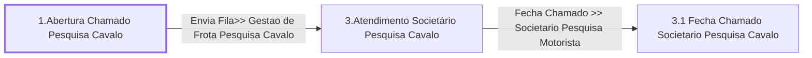

# Processo - Chamado Pesquisa Novo Cavalo

**Chamado Pesquisa Novo Cavalo** — estado **Active** · criado 2021-04-07 15:19:34 · alterado 2026-09-03 09:53:53

Hub: [[Hub - OTRS Processos]] · [[Hub - OTRS]] · [[otrs]]

Início: **1.Abertura Chamado Pesquisa Cavalo** → diálogo [[Dialog - Formulario Pesquisa Cavalo (5b65d9)]]

## Fluxo

## Atividades e diálogos
- **1.Abertura Chamado Pesquisa Cavalo** (início): [[Dialog - Formulario Pesquisa Cavalo (5b65d9)]]
- **3.1 Fecha Chamado Societario Pesquisa Cavalo**: [[Dialog - Formulario Pesquisa Cavalo (5b65d9)]]
- **3.Atendimento Societário Pesquisa Cavalo**: [[Dialog - Formulario Pesquisa Cavalo (5b65d9)]] · [[Dialog - Controle Atendimento Processo (aadcb8)]]

## Transições
- **Envia Fila>> Gestao de Frota Pesquisa Cavalo**: 1.Abertura Chamado Pesquisa Cavalo → 3.Atendimento Societário Pesquisa Cavalo
  - Condição: (and: [[DF - PesqCavalo]] Regexp `.`)
  - Ação *Atribuir fila CRC* — TicketQueueSet: Fila [[Fila - CRC]]
  - Ação *Atribui>>Titulo Processo Pesquisa Cavalo* — TicketTitleSet: Title=`Pesquisa Cavalo : <OTRS_TICKET_DynamicField_PesqCavalo> | Carreta : <OTRS_TICKET_DynamicField_PesqCavaloPlacaCarreta>`
  - Ação *Atribui>>Servico Processo: Chamado Pesquisa Novo Cavalo* — TicketServiceSet: Serviço [[Servico - Processo- Chamado Pesquisa Novo Cavalo]]
- **Fecha Chamado >> Societario Pesquisa Motorista**: 3.Atendimento Societário Pesquisa Cavalo → 3.1 Fecha Chamado Societario Pesquisa Cavalo
  - Condição: (and: [[DF - CteControleAtividades]] String `Finalizar Atendimento Societario`)
  - Ação *Muda Estado Chamado >> Fechado* — TicketStateSet: StateID=`2`

## ACLs que se aplicam (diretas ou por diálogo)
- nenhuma

> Fonte: snapshot do repo (espelho da prod); fila/serviço aparecem como nomes nas ações.
