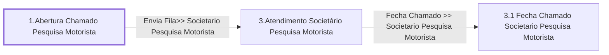

# Processo - Chamado Pesquisa Novo Motorista

**Chamado Pesquisa Novo Motorista** — estado **Active** · criado 2021-04-06 16:51:03 · alterado 2021-12-15 13:45:59

Hub: [[Hub - OTRS Processos]] · [[Hub - OTRS]] · [[otrs]]

Início: **1.Abertura Chamado Pesquisa Motorista** → diálogo [[Dialog - Formulario Pesquisa Motorista]]

## Fluxo

## Atividades e diálogos
- **1.Abertura Chamado Pesquisa Motorista** (início): [[Dialog - Formulario Pesquisa Motorista]]
- **3.1 Fecha Chamado Societario Pesquisa Motorista**: —
- **3.Atendimento Societário Pesquisa Motorista**: [[Dialog - Formulario Pesquisa Motorista]] · [[Dialog - Controle Atendimento Processo (aadcb8)]]

## Transições
- **Fecha Chamado >> Societario Pesquisa Motorista**: 3.Atendimento Societário Pesquisa Motorista → 3.1 Fecha Chamado Societario Pesquisa Motorista
  - Condição: (and: [[DF - CteControleAtividades]] String `Finalizar Atendimento Societario`)
  - Ação *Muda Estado Chamado >> Fechado* — TicketStateSet: StateID=`2`
- **Envia Fila>> Societario Pesquisa Motorista**: 1.Abertura Chamado Pesquisa Motorista → 3.Atendimento Societário Pesquisa Motorista
  - Condição: (and: [[DF - MotoristaCPF]] Regexp `.`; [[DF - MotoristaNome]] Regexp `.`)
  - Ação *Envia Fila>> Societario Pesquisa Motorista* — TicketQueueSet: Fila [[Fila - CRC]]
  - Ação *Atribui>>Serviço Processo: Chamado Pesquisa Novo Motorista* — TicketServiceSet: Serviço [[Servico - Processo- Chamado Pesquisa Novo Motorista]]
  - Ação *Atribui>>Titulo Processo Pesquisa Motorista* — TicketTitleSet: Title=`Motorista: <OTRS_TICKET_DynamicField_MotoristaNome> | Cavalo :<OTRS_TICKET_DynamicField_MotoristaCavalo> |`

## ACLs que se aplicam (diretas ou por diálogo)
- [[ACL - 8-  Esconde Formulário Pesquisa Motorista se Chamado Encerrado]]

> Fonte: snapshot do repo (espelho da prod); fila/serviço aparecem como nomes nas ações.
