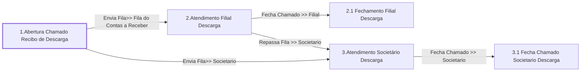

# Processo - Chamado Recibo de Descarga

**Chamado Recibo de Descarga** — estado **Active** · criado 2021-01-11 15:17:38 · alterado 2023-07-12 08:49:16

Hub: [[Hub - OTRS Processos]] · [[Hub - OTRS]] · [[otrs]]

Início: **1.Abertura Chamado Recibo de Descarga** → diálogo [[Dialog - Formulario Recibo de Descarga]]

## Fluxo

## Atividades e diálogos
- **1.Abertura Chamado Recibo de Descarga** (início): [[Dialog - Formulario Recibo de Descarga]]
- **2.1 Fechamento Filial Descarga**: [[Dialog - Formulario Recibo de Descarga]]
- **2.Atendimento Filial Descarga**: [[Dialog - Formulario Recibo de Descarga]] · [[Dialog - Controle Atendimento Processo (b2e090)]]
- **3.1 Fecha Chamado Societario Descarga**: [[Dialog - Formulario Recibo de Descarga]]
- **3.Atendimento Societário Descarga**: [[Dialog - Formulario Recibo de Descarga]] · [[Dialog - Controle Atendimento Processo (b2e090)]]

## Transições
- **Fecha Chamado >> Societario**: 3.Atendimento Societário Descarga → 3.1 Fecha Chamado Societario Descarga
  - Condição: (and: [[DF - CteControleAtividades]] String `Finalizar Atendimento Societario`; [[DF - CteDB]] Regexp `.`; [[DF - CtePlaca]] Regexp `.`)
  - Ação *Muda Estado Chamado >> Fechado* — TicketStateSet: StateID=`2`
- **Envia Fila>> Societario**: 1.Abertura Chamado Recibo de Descarga → 3.Atendimento Societário Descarga
  - Condição: (and: [[DF - CteClienteTipoNestle]] String `NAONESTLE`; [[DF - CteDB]] Regexp `.`; [[DF - CtePlaca]] Regexp `.`)
  - Ação *Envia Fila>> Societario* — TicketQueueSet: Fila [[Fila - CRC]]
  - Ação *Atribui>>Titulo Processo* — TicketTitleSet: Title=`Placa: <OTRS_TICKET_DynamicField_CtePlaca> | CT-e :<OTRS_TICKET_DynamicField_CteNumero> | Cliente : <OTRS_TICKET_DynamicField_CteNomePagador>`
  - Ação *Atribui>>Serviço Processo: Chamado Recibo de Descarga* — TicketServiceSet: Serviço [[Servico - Processo- Chamado Recibo de Descarga]]
- **Envia Fila>> Fila do Contas a Receber**: 1.Abertura Chamado Recibo de Descarga → 2.Atendimento Filial Descarga
  - Condição: (and: [[DF - CteClienteTipoNestle]] String `NESTLE`; [[DF - CteDB]] Regexp `.`; [[DF - CtePlaca]] Regexp `.`)
  - Ação *Envia Fila>> Contas Receber* — TicketQueueSet: Fila [[Fila - Contas a Receber]]
  - Ação *Atribui>>Titulo Recibo de Descarga* — TicketTitleSet: Title=`Placa: <OTRS_TICKET_DynamicField_CtePlaca> | CT-e :<OTRS_TICKET_DynamicField_CteNumero> | Cliente : <OTRS_TICKET_DynamicField_CteNomePagador>`
  - Ação *Atribui>>Serviço Processo: Chamado Recibo de Descarga* — TicketServiceSet: Serviço [[Servico - Processo- Chamado Recibo de Descarga]]
- **Fecha Chamado >> Filial**: 2.Atendimento Filial Descarga → 2.1 Fechamento Filial Descarga
  - Condição: (and: [[DF - CteControleAtividades]] String `Finalizar Atendimento Filial`; [[DF - CteDB]] Regexp `.`; [[DF - CtePlaca]] Regexp `.`)
  - Ação *Muda Estado Chamado >> Fechado* — TicketStateSet: StateID=`2`
- **Repassa Fila >> Societario**: 2.Atendimento Filial Descarga → 3.Atendimento Societário Descarga
  - Condição: (and: [[DF - CteControleAtividades]] String `Repasse Societario`; [[DF - CteDB]] Regexp `.`; [[DF - CtePlaca]] Regexp `.`)
  - Ação *Envia Fila>> Societario* — TicketQueueSet: Fila [[Fila - CRC]]

## ACLs que se aplicam (diretas ou por diálogo)
- [[ACL - 1 - Esconde Campos Chamado - Ativo]]
- [[ACL - 1- Esconde Anexo Recibo Descarga]]
- [[ACL - 1- Esconde Nota Débito MARFRIG DIÁRIA AO DESCARREGAR]]
- [[ACL - 1- Esconde Senha Marfrig HelpDeskTransportador]]
- [[ACL - 2 - Mostra Anexo Comprovante de Entrega - Recibo de Descarga]]
- [[ACL - 2- Mostra Anexo Recibo de Descarga]]
- [[ACL - 2- Mostra Anexo Recibo de Descarga(copiar)1]]
- [[ACL - 2- Mostra Campos Chamado]]
- [[ACL - 2- Mostra NotaDébito Marfrig Processo - DIÁRIA AO DESCARREGAR]]
- [[ACL - 2- Mostra Senha Marfrig Processo - Recibo de Descarga nao obrigatorio]]

> Fonte: snapshot do repo (espelho da prod); fila/serviço aparecem como nomes nas ações.
