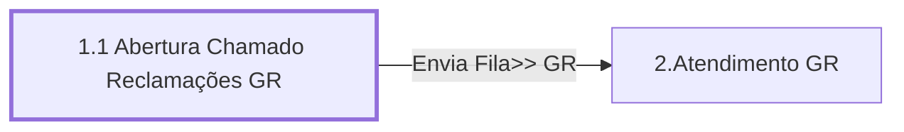

# Processo - Chamado Reclamações GR

**Chamado Reclamações GR** — estado **Active** · criado 2021-10-13 11:20:02 · alterado 2021-12-15 13:46:16

Hub: [[Hub - OTRS Processos]] · [[Hub - OTRS]] · [[otrs]]

Início: **1.1 Abertura Chamado Reclamações GR** → diálogo [[Dialog - Formulario Reclamações GR]]

## Fluxo

## Atividades e diálogos
- **1.1 Abertura Chamado Reclamações GR** (início): [[Dialog - Formulario Reclamações GR]]
- **2.Atendimento GR**: [[Dialog - Formulario Reclamações GR]]

## Transições
- **Envia Fila>> GR**: 1.1 Abertura Chamado Reclamações GR → 2.Atendimento GR
  - Condição: (and: [[DF - GREscolheFornecedor]] Regexp `.`)
  - Ação *Atribui>>Serviço Reclamação GR* — TicketServiceSet: Serviço [[Servico - GR › Reclamações GR]]
  - Ação *Atribui>>Fila GR* — TicketQueueSet: Fila [[Fila - GR]]
  - Ação *Atribui>>Titulo Processo Reclamação GR* — TicketTitleSet: Title=`<OTRS_TICKET_DynamicField_GREscolheFornecedor> | Proprietário: <OTRS_CUSTOMER_DATA_UserFirstname> <OTRS_CUSTOMER_DATA_UserLastname>`

## ACLs que se aplicam (diretas ou por diálogo)
- nenhuma

> Fonte: snapshot do repo (espelho da prod); fila/serviço aparecem como nomes nas ações.
