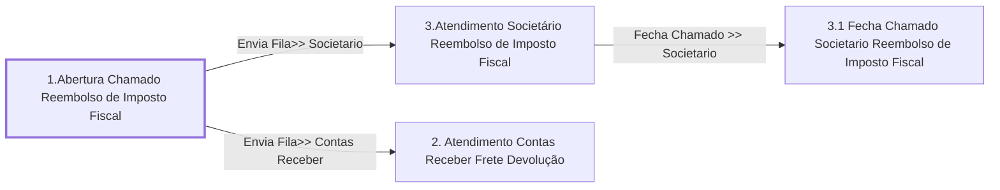

# Processo - Chamado Reembolso de Imposto Fiscal

**Chamado Reembolso de Imposto Fiscal** — estado **Active** · criado 2021-03-25 17:25:17 · alterado 2023-07-03 14:35:24

Hub: [[Hub - OTRS Processos]] · [[Hub - OTRS]] · [[otrs]]

Início: **1.Abertura Chamado Reembolso de Imposto Fiscal** → diálogo [[Dialog - Formulario Reembolso de Imposto Fiscal]]

## Fluxo

## Atividades e diálogos
- **1.Abertura Chamado Reembolso de Imposto Fiscal** (início): [[Dialog - Formulario Reembolso de Imposto Fiscal]]
- **2. Atendimento Contas Receber Frete Devolução**: [[Dialog - Formulário Frete Devolução]]
- **3.1 Fecha Chamado Societario Reembolso de Imposto Fiscal**: [[Dialog - Formulario Reembolso de Imposto Fiscal]]
- **3.Atendimento Societário Reembolso de Imposto Fiscal**: [[Dialog - Formulario Reembolso de Imposto Fiscal]]

## Transições
- **Fecha Chamado >> Societario**: 3.Atendimento Societário Reembolso de Imposto Fiscal → 3.1 Fecha Chamado Societario Reembolso de Imposto Fiscal
  - Condição: (and: [[DF - CteControleAtividades]] String `Finalizar Atendimento Societario`; [[DF - CteDB]] Regexp `.`; [[DF - CtePlaca]] Regexp `.`)
- **Envia Fila>> Societario**: 1.Abertura Chamado Reembolso de Imposto Fiscal → 3.Atendimento Societário Reembolso de Imposto Fiscal
  - Condição: (and: [[DF - CteClienteTipoNestle]] String `CLIENTENAONESTLE`; [[DF - CteDB]] Regexp `.`; [[DF - CtePlaca]] Regexp `.`)
  - Ação *Envia Fila>> Societario* — TicketQueueSet: Fila [[Fila - CRC]]
  - Ação *Atribui>>Serviço Processo: Chamado Reembolso de Imposto Fiscal* — TicketServiceSet: Serviço [[Servico - Processo- Chamado Reembolso de Imposto Fiscal]]
  - Ação *Atribui>>Titulo Processo* — TicketTitleSet: Title=`Placa: <OTRS_TICKET_DynamicField_CtePlaca> | CT-e :<OTRS_TICKET_DynamicField_CteNumero> | Cliente : <OTRS_TICKET_DynamicField_CteNomePagador>`
- **Envia Fila>> Contas Receber**: 1.Abertura Chamado Reembolso de Imposto Fiscal → 2. Atendimento Contas Receber Frete Devolução
  - Condição: (and: [[DF - CteClienteTipoNestle]] String `NESTLE`; [[DF - CteDB]] Regexp `.`; [[DF - CtePlaca]] Regexp `.`)
  - Ação *Envia Fila>> Contas Receber* — TicketQueueSet: Fila [[Fila - Contas a Receber]]
  - Ação *Atribui>>Serviço Processo: Chamado Reembolso de Imposto Fiscal* — TicketServiceSet: Serviço [[Servico - Processo- Chamado Reembolso de Imposto Fiscal]]
  - Ação *Atribui>>Titulo Reembolso de Imposto Fiscal* — TicketTitleSet: Title=`Placa: <OTRS_TICKET_DynamicField_CtePlaca> | CT-e :<OTRS_TICKET_DynamicField_CteNumero> | Cliente : <OTRS_TICKET_DynamicField_CteNomePagador>`

## ACLs que se aplicam (diretas ou por diálogo)
- [[ACL - 2- Mostra Campos Chamado]]

> Fonte: snapshot do repo (espelho da prod); fila/serviço aparecem como nomes nas ações.
