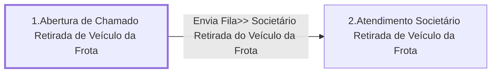

# Processo - Chamado Retirada de Veículo da Frota

**Chamado Retirada de Veículo da Frota** — estado **Active** · criado 2021-10-20 10:20:19 · alterado 2021-12-15 13:46:31

Hub: [[Hub - OTRS Processos]] · [[Hub - OTRS]] · [[otrs]]

Início: **1.Abertura de Chamado Retirada de Veículo da Frota** → diálogo [[Dialog - 1 - Formulário Retirada de Veículo da Frota]]

## Fluxo

## Atividades e diálogos
- **1.Abertura de Chamado Retirada de Veículo da Frota** (início): [[Dialog - 1 - Formulário Retirada de Veículo da Frota]]
- **2.Atendimento Societário Retirada de Veículo da Frota**: —

## Transições
- **Envia Fila>> Societário Retirada do Veículo da Frota**: 1.Abertura de Chamado Retirada de Veículo da Frota → 2.Atendimento Societário Retirada de Veículo da Frota
  - Condição: (and: [[DF - Placa]] Regexp `.`)
  - Ação *Envia Fila>> Societário Retirada do Veículo da Frota* — TicketQueueSet: Fila [[Fila - CRC]]
  - Ação *Atribuir>>Titulo Processo: Retirada de Veículo da Frota* — TicketTitleSet: Title=`Processo: Chamado Retirada de Veículo da Frota, placa: <OTRS_TICKET_DynamicField_Placa>`
  - Ação *Atribuir>>Serviço Processo: Chamado Retirada de Veículo da Frota* — TicketServiceSet: Serviço [[Servico - Processo- Chamado Retirada de Veículo da Frota]]

## ACLs que se aplicam (diretas ou por diálogo)
- nenhuma

> Fonte: snapshot do repo (espelho da prod); fila/serviço aparecem como nomes nas ações.
