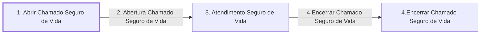

# Processo - Chamado Seguro de Vida

**Chamado Seguro de Vida** — estado **Active** · criado 2022-07-18 08:37:14 · alterado 2022-07-18 15:38:37

Hub: [[Hub - OTRS Processos]] · [[Hub - OTRS]] · [[otrs]]

Início: **1. Abrir Chamado Seguro de Vida** → diálogo [[Dialog - 1.1 Formulário Seguro de Vida]]

## Fluxo

## Atividades e diálogos
- **1. Abrir Chamado Seguro de Vida** (início): [[Dialog - 1.1 Formulário Seguro de Vida]]
- **3. Atendimento Seguro de Vida**: [[Dialog - 1.1 Formulário Seguro de Vida]]
- **4.Encerrar Chamado Seguro de Vida**: —

## Transições
- **4.Encerrar Chamado Seguro de Vida**: 3. Atendimento Seguro de Vida → 4.Encerrar Chamado Seguro de Vida
  - Condição: (and: `<OTRS_TICKET_State>` String `closed successful`) and (or: `<OTRS_TICKET_State>` String `pending auto close+`)
- **2. Abertura Chamado Seguro de Vida**: 1. Abrir Chamado Seguro de Vida → 3. Atendimento Seguro de Vida
  - Condição: (and: [[DF - NomeAssegurado]] Regexp `.`)
  - Ação *2.2 Abrir Chamado Seguro de Vida - Fila* — TicketQueueSet: Fila [[Fila - CRC]]
  - Ação *2.3 Abrir Chamado Seguro de Vida - Serviço* — TicketServiceSet: Serviço [[Servico - CRC › Seguro de Vida]]
  - Ação *2.1 Abrir Chamado Seguro de Vida - SLA* — TicketSLASet: SLA [[SLA - SLA Padrão]]
  - Ação *2.4 Abrir Chamado Seguro de Vida - Título* — TicketTitleSet: Title=`Solicitação Seguro de Vida <OTRS_CUSTOMER_DATA_UserFirstname> <OTRS_CUSTOMER_DATA_UserLastname>`
  - Ação *2.5 Abrir Chamado Seguro de Vida - Solicitante* — DynamicFieldSet: NomeCooperado=`<OTRS_CUSTOMER_DATA_UserFirstname> <OTRS_CUSTOMER_DATA_UserLastname>`

## ACLs que se aplicam (diretas ou por diálogo)
- [[ACL - 11 - Esconde Campos Seguro de Vida]]
- [[ACL - 11 - Mostra Campos Seguro de Vida]]

> Fonte: snapshot do repo (espelho da prod); fila/serviço aparecem como nomes nas ações.
