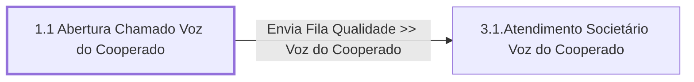

# Processo - Chamado Voz do Cooperado

**Chamado Voz do Cooperado** — estado **Active** · criado 2021-06-10 09:49:25 · alterado 2021-12-15 13:46:38

Hub: [[Hub - OTRS Processos]] · [[Hub - OTRS]] · [[otrs]]

Início: **1.1 Abertura Chamado Voz do Cooperado** → diálogo [[Dialog - 1 - Formulário Voz do Cooperado]]

## Fluxo

## Atividades e diálogos
- **1.1 Abertura Chamado Voz do Cooperado** (início): [[Dialog - 1 - Formulário Voz do Cooperado]]
- **3.1.Atendimento Societário Voz do Cooperado**: [[Dialog - Formulário Voz do Cooperado]]

## Transições
- **Envia Fila Qualidade >> Voz do Cooperado**: 1.1 Abertura Chamado Voz do Cooperado → 3.1.Atendimento Societário Voz do Cooperado
  - Condição: (and: `Subject` Regexp `.`)
  - Ação *Envia Fila>> Societário Voz do Cooperado* — TicketQueueSet: Fila [[Fila - Qualidade]]
  - Ação *Atribui>>Titulo Processo Voz do Cooperado* — TicketTitleSet: Title=`Voz do Cooperado`
  - Ação *Atribui>>Serviço Processo: Chamado Voz do Cooperado* — TicketServiceSet: Serviço [[Servico - Processo- Chamado Voz do Cooperado]]

## ACLs que se aplicam (diretas ou por diálogo)
- nenhuma

> Fonte: snapshot do repo (espelho da prod); fila/serviço aparecem como nomes nas ações.
