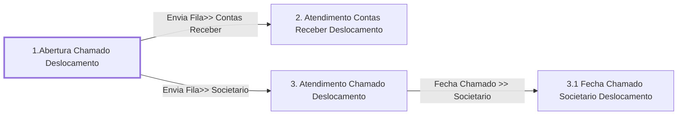

# Processo - Chamado de Deslocamento

**Chamado de Deslocamento** — estado **Active** · criado 2021-01-11 15:19:27 · alterado 2023-07-03 15:41:34

Hub: [[Hub - OTRS Processos]] · [[Hub - OTRS]] · [[otrs]]

Início: **1.Abertura Chamado Deslocamento** → diálogo [[Dialog - Formulario Deslocamento]]

## Fluxo

## Atividades e diálogos
- **1.Abertura Chamado Deslocamento** (início): [[Dialog - Formulario Deslocamento]]
- **2. Atendimento Contas Receber Deslocamento**: [[Dialog - Formulario Deslocamento]]
- **3. Atendimento Chamado Deslocamento**: [[Dialog - Formulario Deslocamento]]
- **3.1 Fecha Chamado Societario Deslocamento**: [[Dialog - Formulario Deslocamento]]

## Transições
- **Envia Fila>> Societario**: 1.Abertura Chamado Deslocamento → 3. Atendimento Chamado Deslocamento
  - Condição: (and: [[DF - CteClienteTipoNestle]] String `NAONESTLE`; [[DF - CteDB]] Regexp `.`; [[DF - CtePlaca]] Regexp `.`)
  - Ação *Envia Fila>> Societario Chamado Deslocamento* — TicketQueueSet: Fila [[Fila - CRC]]
  - Ação *Atribui>>Serviço Processo: Chamado Deslocamento* — TicketServiceSet: Serviço [[Servico - Processo- Chamado de Deslocamento]]
  - Ação *Atribui>>Titulo Processo* — TicketTitleSet: Title=`Placa: <OTRS_TICKET_DynamicField_CtePlaca> | CT-e :<OTRS_TICKET_DynamicField_CteNumero> | Cliente : <OTRS_TICKET_DynamicField_CteNomePagador>`
- **Envia Fila>> Contas Receber**: 1.Abertura Chamado Deslocamento → 2. Atendimento Contas Receber Deslocamento
  - Condição: (and: [[DF - CteClienteTipoNestle]] String `NESTLE`; [[DF - CteDB]] Regexp `.`; [[DF - CtePlaca]] Regexp `.`)
  - Ação *Envia Fila>> Contas Receber* — TicketQueueSet: Fila [[Fila - Contas a Receber]]
  - Ação *Atribui>>Serviço Processo: Chamado Deslocamento* — TicketServiceSet: Serviço [[Servico - Processo- Chamado de Deslocamento]]
- **Fecha Chamado >> Societario**: 3. Atendimento Chamado Deslocamento → 3.1 Fecha Chamado Societario Deslocamento
  - Condição: (and: [[DF - CteControleAtividades]] String `Finalizar Atendimento Societario`; [[DF - CteDB]] Regexp `.`; [[DF - CtePlaca]] Regexp `.`)
  - Ação *Muda Estado Chamado >> Fechado* — TicketStateSet: StateID=`2`

## ACLs que se aplicam (diretas ou por diálogo)
- [[ACL - 1 - Esconde Campos Chamado - Ativo]]
- [[ACL - 1- Esconde Nota Débito MARFRIG DIÁRIA AO DESCARREGAR]]
- [[ACL - 1- Esconde Numero Registro BRF  DIÁRIA AO DESCARREGAR]]
- [[ACL - 1- EscondeCteSenhaBRF Deslocamento]]
- [[ACL - 2- Mostra Campos Chamado]]
- [[ACL - 2- Mostra CteSenhaBRF Processo - DESLOCAMENTO]]
- [[ACL - 2- Mostra NotaDébito Marfrig Processo - DIÁRIA AO DESCARREGAR]]
- [[ACL - 2- Mostra Numero Registro BRF Processo - DIÁRIA AO DESCARREGAR]]

> Fonte: snapshot do repo (espelho da prod); fila/serviço aparecem como nomes nas ações.
