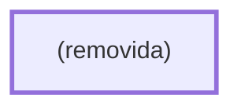

# Processo - Chamado de Diária

**Chamado de Diária** — estado **Inactive** · criado 2026-01-20 10:50:33 · alterado 2026-01-20 10:50:33

Hub: [[Hub - OTRS Processos]] · [[Hub - OTRS]] · [[otrs]]

Início: **?** → diálogo (?)

## Fluxo

## Atividades e diálogos
- **(removida)** (início): —

## Transições

## ACLs que se aplicam (diretas ou por diálogo)
- nenhuma

> Fonte: snapshot do repo (espelho da prod); fila/serviço aparecem como nomes nas ações.
