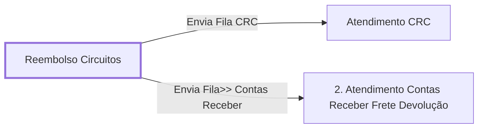

# Processo - Reembolso Circuitos

**Reembolso Circuitos** — estado **Inactive** · criado 2022-05-04 08:42:36 · alterado 2023-10-30 08:44:03

Hub: [[Hub - OTRS Processos]] · [[Hub - OTRS]] · [[otrs]]

Início: **Reembolso Circuitos** → diálogo [[Dialog - Abre Chamado Reembolso Circuitos]]

## Fluxo

## Atividades e diálogos
- **2. Atendimento Contas Receber Frete Devolução**: [[Dialog - Formulário Frete Devolução]]
- **Atendimento CRC**: —
- **Reembolso Circuitos** (início): [[Dialog - Abre Chamado Reembolso Circuitos]]

## Transições
- **Envia Fila CRC**: Reembolso Circuitos → Atendimento CRC
  - Condição: (and: [[DF - CTeReembolsoCircuitos]] Regexp `.`)
  - Ação *Envia Fila>> Societario* — TicketQueueSet: Fila [[Fila - CRC]]
  - Ação *Serviço Reembolso Circuitos CRC* — TicketServiceSet: Serviço [[Servico - Processo- Reembolso Circuitos]]
- **Envia Fila>> Contas Receber**: Reembolso Circuitos → 2. Atendimento Contas Receber Frete Devolução
  - Condição: (and: [[DF - CteClienteTipoNestle]] String `NESTLE`; [[DF - CteDB]] Regexp `.`; [[DF - CtePlaca]] Regexp `.`)

## ACLs que se aplicam (diretas ou por diálogo)
- [[ACL - 2- Mostra Campos Chamado]]

> Fonte: snapshot do repo (espelho da prod); fila/serviço aparecem como nomes nas ações.
