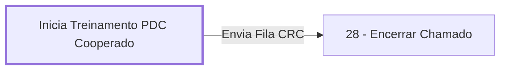

# Processo - Treinamento PDC Cooperado

**Treinamento PDC Cooperado** — estado **Active** · criado 2023-01-04 08:59:19 · alterado 2023-01-04 11:10:04

Hub: [[Hub - OTRS Processos]] · [[Hub - OTRS]] · [[otrs]]

Início: **Inicia Treinamento PDC Cooperado** → diálogo [[Dialog - Formulário TREINAMENTO PDC COOPERADO]]

## Fluxo

## Atividades e diálogos
- **28 - Encerrar Chamado**: —
- **Inicia Treinamento PDC Cooperado** (início): [[Dialog - Formulário TREINAMENTO PDC COOPERADO]]

## Transições
- **Envia Fila CRC**: Inicia Treinamento PDC Cooperado → 28 - Encerrar Chamado
  - Condição: (and: [[DF - CTeReembolsoCircuitos]] Regexp `.`)

## ACLs que se aplicam (diretas ou por diálogo)
- nenhuma

> Fonte: snapshot do repo (espelho da prod); fila/serviço aparecem como nomes nas ações.
