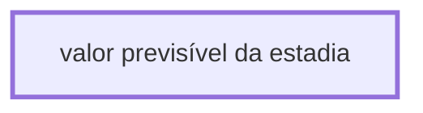

# Processo - valor previsível da estadia

**valor previsível da estadia** — estado **Active** · criado 2026-07-28 09:37:06 · alterado 2026-07-28 09:54:03

Hub: [[Hub - OTRS Processos]] · [[Hub - OTRS]] · [[otrs]]

Início: **valor previsível da estadia** → diálogo [[Dialog - Adcionar Valor Previsível da Estadia]]

## Fluxo

## Atividades e diálogos
- **valor previsível da estadia** (início): [[Dialog - Adcionar Valor Previsível da Estadia]]

## Transições

## ACLs que se aplicam (diretas ou por diálogo)
- nenhuma

> Fonte: snapshot do repo (espelho da prod); fila/serviço aparecem como nomes nas ações.
